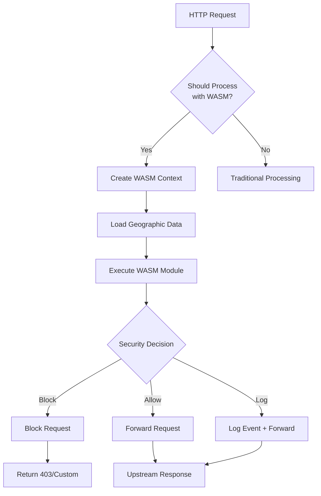
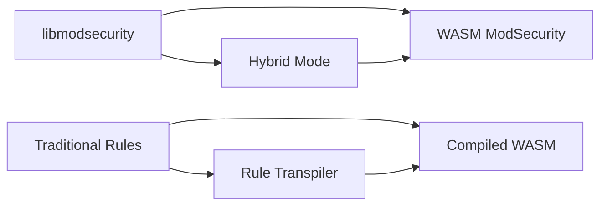

# WAF WASM Integration Documentation

## 🎯 Overview

The WAF-Rejected platform includes a comprehensive WASM-based ModSecurity integration that provides:

- **Sandboxed Security Processing**: Rule execution in isolated WASM environments
- **Hot-Reloadable Rules**: Dynamic rule updates without service restart
- **Geographic Context Integration**: Enhanced rule processing with geo-aware data
- **High Performance**: Optimized WASM runtime with pooling allocators

## 🏗️ Architecture

### Core Components

```
┌─────────────────────────────────────────────────────────────┐
│                    WASM ModSecurity Engine                  │
├─────────────────┬─────────────────┬─────────────────────────┤
│   WASM Runtime  │  Component Mgr  │    Context Manager      │
│   (wasmtime)    │  (bindings)     │  (geo + security)       │
└─────────────────┴─────────────────┴─────────────────────────┘
                           │
┌─────────────────────────────────────────────────────────────┐
│                    Host Functions                          │
├─────────────────┬─────────────────┬─────────────────────────┤
│  Event Logging  │  Threat Intel   │    K/V Integration      │
│  (structured)   │  (queries)      │   (geographic data)     │
└─────────────────┴─────────────────┴─────────────────────────┘
```

### Request Processing Flow



## 🛠️ Features

### 1. **WASM Engine** (`src/wasm/engine.rs`)

**Capabilities:**
- Async WASM execution with timeout protection
- Memory-limited sandboxed environments
- Instance pooling for performance optimization
- Module hot-reloading support

**Configuration:**
```toml
[wasm]
enabled = true
module_path = "rules/modsecurity.wasm"
memory_limit = 16777216  # 16MB
execution_timeout_ms = 100
debug_mode = false
```

**Key Methods:**
- `WasmEngine::new(config)` - Initialize engine
- `load_module()` - Load/reload WASM module
- `process_request(ctx)` - Process HTTP request
- `statistics()` - Get performance metrics

### 2. **Request Context** (`src/wasm/context.rs`)

**Features:**
- Comprehensive HTTP request representation
- Geographic context integration for K/V store
- Security metadata (rate limiting, session info)
- Memory-efficient serialization

**Context Structure:**
```rust
pub struct WasmRequestContext {
    pub method: String,
    pub uri: String,
    pub headers: HashMap<String, String>,
    pub client_ip: String,
    pub body: Option<Vec<u8>>,
    pub geo_context: Option<GeoContext>,
    pub security_metadata: SecurityMetadata,
}
```

### 3. **Component Bindings** (`src/wasm/bindings.rs`)

**Interface Definition:**
- Component model integration
- Host function bindings
- Security decision types
- Error handling protocols

**Security Decisions:**
```rust
pub enum SecurityDecision {
    Allow,
    Block { rule_id: String, message: String, severity: Severity },
    Log { rule_id: String, message: String, severity: Severity },
    Challenge { challenge_type: ChallengeType, message: String },
}
```

## 🚀 Usage Examples

### Basic WASM Engine Usage

```rust
use crate::wasm::{WasmEngine, WasmEngineConfig, WasmRequestContext};

#[tokio::main]
async fn main() -> Result<()> {
    // Initialize WASM engine
    let config = WasmEngineConfig {
        module_path: "rules/modsecurity.wasm".to_string(),
        memory_limit: Some(16 * 1024 * 1024),
        execution_timeout_ms: 100,
        ..Default::default()
    };
    
    let engine = WasmEngine::new(config).await?;
    
    // Create request context
    let ctx = WasmRequestContext::from_http_request(
        "GET",
        "/api/users",
        &[("Host", "example.com")],
        "192.168.1.100",
        None,
    );
    
    // Process request
    let result = engine.process_request(&ctx).await?;
    
    match result {
        WasmSecurityResult::Allow => {
            println!("Request allowed");
        }
        WasmSecurityResult::Block { rule_id, message } => {
            println!("Request blocked by rule {}: {}", rule_id, message);
        }
        _ => {}
    }
    
    Ok(())
}
```

### Geographic Context Integration

```rust
use crate::wasm::context::{GeoContext, ThreatIndicator, ThreatType};

let geo_context = GeoContext {
    country: "US".to_string(),
    region: Some("California".to_string()),
    city: Some("San Francisco".to_string()),
    isp: Some("Cloudflare".to_string()),
    asn: Some(13335),
    threat_flags: vec!["clean".to_string()],
};

let ctx = WasmRequestContext::from_http_request(
    "POST", 
    "/api/sensitive",
    &[("Content-Type", "application/json")],
    "203.0.113.1",
    Some(b"{\"data\":\"sensitive\"}"),
).with_geo_context(geo_context);

let result = engine.process_request(&ctx).await?;
```

### Module Hot-Reloading

```rust
// Monitor for rule file changes
tokio::spawn(async move {
    let mut watcher = notify::recommended_watcher(tx).unwrap();
    watcher.watch("rules/", notify::RecursiveMode::Recursive).unwrap();
    
    while let Ok(event) = rx.recv() {
        if let Ok(Event { kind: EventKind::Modify(_), .. }) = event {
            // Reload WASM module
            if let Err(e) = engine.load_module().await {
                error!("Failed to reload WASM module: {}", e);
            } else {
                info!("WASM module reloaded successfully");
            }
        }
    }
});
```

## ⚙️ Build Configuration

### Feature Flags

```toml
[features]
default = ["wasm-waf", "export-system"]
wasm-waf = ["wasmtime", "wasmtime-wasi", "wasmtime-wasi-http"]
```

### Build Commands

```bash
# Full build with WASM support
cargo build --release

# WASM-only build (no exports)
cargo build --no-default-features --features wasm-waf

# Build without WASM (traditional ModSecurity)
cargo build --no-default-features --features export-system

# Development build with debugging
cargo build --features wasm-waf --profile dev
```

### Dependency Optimization

The WASM dependencies are optional and controlled by feature flags:

```toml
# Optional WASM runtime dependencies
wasmtime = { version = "26.0", features = ["component-model", "async", "pooling-allocator"], optional = true }
wasmtime-wasi = { version = "26.0", optional = true }
wasmtime-wasi-http = { version = "26.0", optional = true }
```

**Benefits:**
- Reduced binary size when WASM not needed
- Faster compilation times
- Modular deployment options

## 📊 Performance Characteristics

### Memory Management

- **Sandbox Isolation**: Each WASM instance runs in isolated memory
- **Pooling**: Instance pooling reduces allocation overhead
- **Memory Limits**: Configurable per-instance memory limits
- **Garbage Collection**: Automatic cleanup of unused instances

### Execution Performance

- **Timeout Protection**: Configurable execution timeouts
- **Async Processing**: Non-blocking request processing
- **Batch Operations**: Efficient rule loading and processing
- **JIT Compilation**: Wasmtime's optimizing compiler

### Benchmarks (Estimated)

```
Request Processing:
├── WASM Overhead: ~50-100μs
├── Rule Execution: ~100-500μs 
├── Context Serialization: ~10-50μs
└── Total Latency: ~160-650μs

Memory Usage:
├── Base Engine: ~2-5MB
├── Per Instance: ~1-2MB
├── Request Context: ~1-10KB
└── Peak Usage: ~10-50MB (with pooling)
```

## 🔧 Configuration Reference

### WASM Engine Configuration

```toml
[wasm]
# Enable WASM ModSecurity engine
enabled = true

# Path to compiled WASM module
module_path = "rules/modsecurity.wasm"

# Memory limit per WASM instance (bytes)
memory_limit = 16777216  # 16MB

# Maximum execution time per request (milliseconds)
execution_timeout_ms = 100

# Enable debug mode (slower but more information)
debug_mode = false

# Enable async execution (recommended)
async_execution = true

# Instance pool configuration
[wasm.pooling]
max_instances = 100
instance_reuse = true
gc_interval_seconds = 300
```

### Geographic Integration

```toml
[geo]
# Enable geographic context
enabled = true

# K/V store integration for geo data
kv_store_endpoint = "https://geo-kv.internal:8080"

# Cache settings
cache_ttl_seconds = 3600
max_cache_entries = 10000

# Threat intelligence integration
threat_intel_enabled = true
threat_intel_sources = ["internal", "commercial", "osint"]
```

## 🧪 Testing

### Unit Tests

```bash
# Test WASM components
cargo test wasm --features wasm-waf

# Test without WASM
cargo test --no-default-features

# Integration tests
cargo test --features wasm-waf,integration-tests
```

### Performance Testing

```bash
# Benchmark WASM performance
cargo bench --features wasm-waf

# Load testing with WASM
cargo run --bin load-test --features wasm-waf -- --wasm
```

### Module Validation

```bash
# Validate WASM module format
wasmtime validate rules/modsecurity.wasm

# Test module exports
wasmtime inspect rules/modsecurity.wasm --exports
```

## 🔒 Security Considerations

### Sandboxing

- **Memory Isolation**: Each WASM instance has isolated memory
- **Capability Control**: Limited host function access
- **Resource Limits**: CPU and memory usage constraints
- **No System Access**: WASM modules cannot access host system directly

### Attack Surface

- **Reduced**: WASM sandboxing limits potential security issues
- **Controlled**: Only approved host functions are available
- **Auditable**: WASM modules can be inspected and verified
- **Updateable**: Rules can be updated without system access

### Best Practices

1. **Module Validation**: Always validate WASM modules before loading
2. **Resource Limits**: Set appropriate memory and execution limits
3. **Access Control**: Limit host function capabilities
4. **Monitoring**: Track WASM execution metrics and errors
5. **Updates**: Use secure channels for module distribution

## 🔄 Migration Path

### From Traditional ModSecurity



### Migration Steps

1. **Phase 1**: Deploy WASM engine alongside existing
2. **Phase 2**: Migrate select rules to WASM format
3. **Phase 3**: Validate performance and security
4. **Phase 4**: Full migration to WASM-based processing

## 🎯 Production Deployment

### Docker Configuration

```dockerfile
# Multi-stage build with WASM support
FROM rust:1.75 AS builder
WORKDIR /app
COPY Cargo.toml Cargo.lock ./
RUN cargo fetch

COPY src/ src/
RUN cargo build --release --features wasm-waf

FROM debian:bookworm-slim
RUN apt-get update && apt-get install -y ca-certificates
COPY --from=builder /app/target/release/waf-ingress /usr/local/bin/
COPY rules/ /etc/waf/rules/

EXPOSE 8080 8443
ENTRYPOINT ["waf-ingress"]
```

### Kubernetes Deployment

```yaml
apiVersion: apps/v1
kind: Deployment
metadata:
  name: waf-ingress
spec:
  template:
    spec:
      containers:
      - name: waf-ingress
        image: waf-ingress:latest
        env:
        - name: RUST_LOG
          value: "info"
        - name: WAF_WASM_ENABLED
          value: "true"
        resources:
          limits:
            memory: "512Mi"
            cpu: "500m"
          requests:
            memory: "256Mi"
            cpu: "250m"
        volumeMounts:
        - name: rules
          mountPath: /etc/waf/rules
          readOnly: true
      volumes:
      - name: rules
        configMap:
          name: waf-rules
```

## 📈 Monitoring and Observability

### Metrics

- WASM execution time distribution
- Memory usage per instance
- Module load/reload events
- Security decision counts
- Error rates and types

### Logging

```rust
// Structured logging for WASM events
info!(
    wasm.module = %module_path,
    wasm.execution_time_us = execution_time.as_micros(),
    wasm.memory_used = memory_usage,
    wasm.decision = %decision,
    "WASM request processed"
);
```

### Health Checks

```http
GET /health/wasm
{
  "status": "healthy",
  "wasm_engine": {
    "module_loaded": true,
    "instance_pool_size": 5,
    "avg_execution_time_us": 250,
    "memory_usage_mb": 15
  }
}
```

This WASM integration provides a powerful, secure, and scalable foundation for ModSecurity rule processing in the WAF-Rejected platform! 🚀
