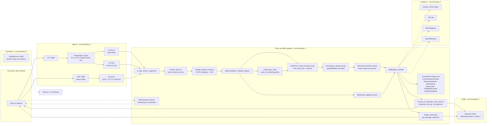

# Security Architecture and Threat Model

**Status:** Beta (`0.1.0-beta.14` plus Unreleased changes), source-verified on
2026-11-05 against commit `d354ab1` after an external documentation audit. This
document describes the controls that are actually implemented in the default
Beta build. **It is not a certification, a CRA conformity assessment or a
substitute for an operator's own risk analysis.** The control-status matrix in
[section 2](#2-control-status-matrix) is the authoritative list of which claims
are implemented, tested or independently verified; prose elsewhere is
subordinate to it. Re-verify the code references whenever the request path
changes.

## 1. Scope and method

This model covers the `waf-ingress` binary: TLS/QUIC ingress, the HTTP proxy,
the WAF rule chain, WebSocket tunnelling, security-event export and the
health/metrics listener. It does not cover the upstream application, the
container runtime, Kubernetes, the operator's identity provider or the SIEM.

The analysis is bottom-up from the source. Each enforcement point below names
the function that implements it. Where a configuration key exists but is not
wired into the request path, that is called out explicitly rather than presented
as a control.

**Status vocabulary used throughout this document and the matrix:**

- **Implemented** — code is compiled into the default feature set (or an
  explicitly named feature) and is wired into the live request path.
- **Tested** — implemented and covered by an automated regression test in this
  repository that exercises the control, not merely the helper function.
- **Verified** — tested, and the behaviour has been independently reproduced by
  a party outside the change author, or checked against a separate
  implementation (the Coraza/CRS differential oracle). Verification is scoped
  to the cited artefact; it is not a certification of the product.
- **Unverified** — implemented or configured, but no automated test or
  independent check establishes the claim. Treat these as design intent.
- **Not implemented** — absent, or present only as a configuration key that the
  request path never reads.

## 2. Control status matrix

This matrix is the audit trail requested by the external review: every security
claim must point at code, at a regression test, and at the release that
introduced it. Rows are deliberately conservative. A blank test cell means "no
automated test", not "tested elsewhere".

**Coverage summary:** 27 rows — 24 implemented and tested (the Rust engine's
CRS parity is additionally checked against the Coraza oracle), 3 **not
implemented**. GeoIP is tested only when licensed databases are supplied and is
therefore unverified in a bare deployment. No other row is marked **Verified**
on the strength of this audit alone; the external review examined documentation,
not each control. `Tested` means the repository has a regression test, not that
an independent penetration test passed.

| Control | Status | Code location | Test location | Introduced in |
|---|---|---|---|---|
| TLS 1.2/1.3 admission, ALPN `h2`, optional client certs | Tested | `src/waf/tls_config.rs` — `TlsManager::new`, `accept`, `selected_versions` | `src/waf/tls_config.rs` unit tests (`versions_respect_min_and_max`, `alpn_defaults_advertise_h2_then_http1`) | beta.1; hardened in beta.2 |
| HTTP-version allowlist (`505` for unlisted versions) | Tested | `src/proxy/service.rs` — `detect_http_version`, `is_http_version_supported` | `tests/integration/pipeline_tests.rs` (protocol cases); `src/proxy/service.rs` unit tests | beta.1 |
| Trusted-proxy client-IP resolution and forwarding-header rewrite | Tested | `src/proxy/service.rs` — `resolve_client_ip`, `build_upstream_request` | `src/proxy/service.rs` unit tests (`test_client_ip_*`, proptest `resolve_client_ip_never_panics_*`) | beta.2 |
| Client routing/override header stripping (same path/method WAF and origin) | Tested | `src/proxy/service.rs` — `HeaderStripPolicy`, `handle_request`; `src/proxy/http3.rs` | `src/proxy/service.rs` unit tests; `tests/integration/pipeline_tests.rs` (`pipeline_strips_routing_headers_*`, `pipeline_rejects_ambiguous_routing_headers_when_enabled`) | Unreleased (H3) |
| API-key authentication and HTTPS requirement | Tested | `src/waf/auth.rs` — `ApiKeyValidator::validate_request`, `InMemoryKeyStore::from_raw_keys` | `tests/integration/auth_tests.rs`; `src/waf/auth.rs` unit tests | beta.1 |
| Ambiguous request-framing rejection (CL/TE smuggling) | Tested | `src/proxy/framing.rs` — `validate_request_framing`; called from `service.rs` and `http3.rs` before body reads | `src/proxy/framing.rs` unit tests; `tests/integration/pipeline_tests.rs` (`pipeline_accepts_chunked_body`, `pipeline_rejects_content_length_mismatch`) | beta.10 |
| Streaming request-body cap and read timeout | Tested | `src/proxy/buffer_pool.rs` — `read_incoming_body`; `src/proxy/service.rs`; `src/proxy/http3.rs` | `tests/integration/pipeline_tests.rs` (`pipeline_rejects_oversized_body`) | beta.1 |
| Bounded request decompression (`gzip`, `deflate`, `br`) | Tested | `src/proxy/decompression.rs` — `decompress_request_body`, `strip_encoding_headers` | `src/proxy/decompression.rs` unit tests; `tests/integration/pipeline_tests.rs` (six decompression cases) | beta.10 |
| Native Rust CRS engine as default backend (505 rules) | Tested; parity **Verified** against the Coraza oracle for the pinned corpus | `src/waf/rust_engine/`; `src/waf/mod.rs` — `add_coraza_rule`, backend selection | `tests/corpus/crs/corpus.json` differential corpus; `tests/integration/native_coraza_tests.rs`; engine unit tests | beta.13 |
| Coraza 3.3.3 WASI reactor as reference and `fallback = "wasm"` | Tested | `src/waf/wasm_reactor.rs`; `src/waf/mod.rs` — backend/fallback selection | `tests/integration/native_coraza_tests.rs`; `tests/corpus/crs/` differential runs | reactor beta.11; default switch-back beta.13 |
| Native Coraza sidecar (opt-in `backend = "native"`) | Tested (feature-gated) | `src/waf/native_coraza.rs`; `native/coraza-sidecar/` | `tests/integration/native_coraza_tests.rs` | beta.12 |
| Traditional content inspection (URI/query/header/body regex, one percent-decode pass) | Tested | `src/waf/content_inspection.rs` — `ContentInspectionRule::evaluate`, `check_with_decoding` | `src/waf/content_inspection.rs` unit tests; fuzz target `fuzz/fuzz_targets/content_inspection.rs` | beta.1 |
| Dangerous-method blocking (`TRACE`, `CONNECT`) | Tested | `src/waf/rules.rs` — `MethodRule::evaluate` | `src/waf/rules.rs` unit tests; `tests/integration/pipeline_tests.rs` | beta.1 |
| Per-IP token-bucket rate limiting, 64 shards, bounded tracked IPs | Tested | `src/waf/rate_limit.rs` — `RateLimiter`, `ShardedBuckets`, `CapacityPolicy` | `src/waf/rate_limit.rs` unit tests (`shards_are_independent_*`, `capacity_*`, `concurrent_access_never_exceeds_capacity`); `benches/rate_limit_shard.rs` | beta.1; sharded/bounded in Unreleased |
| Global token-bucket rate limiting | Tested | `src/waf/rate_limit.rs` — `GlobalRateLimiter` | `src/waf/rate_limit.rs` unit tests | beta.1 |
| Heavy-inspection admission control (`waf.admission`) | Tested | `src/waf/admission.rs` — `AdmissionController::admit`; `src/waf/mod.rs` — `admit`, `inspection_cost` | `src/waf/mod.rs` unit tests (admission suite); `tests/integration/grpc_h2_e2e.rs` saturation cases | beta.12 |
| Geo/anonymity blocking (MaxMind City + Anonymous IP) | Tested when databases are supplied; **Unverified** without them | `src/waf/geoip.rs` — `GeoIpService`, `GeoBlockingRule::evaluate` | `tests/integration/maxmind_tests.rs` (skipped without local `.mmdb`) | beta.1; anonymous DB later |
| gRPC unary body inspection, incl. no `content-length` and delayed `END_STREAM` | Tested | `src/proxy/grpc_body.rs` — `probe_grpc_body`; `src/waf/grpc.rs` — `GrpcInspector::inspect` | `src/proxy/grpc_body.rs` unit tests; `tests/integration/grpc_h2_e2e.rs` (`unary_grpc_without_content_length_is_inspected`, `delayed_end_stream_unary_is_still_inspected`) | Unreleased (P0 fix) |
| gRPC streaming policy (`reject` default, explicit `transport-only`) with per-message inspection and whole-stream bounds | Tested | `src/proxy/service.rs` — `handle_grpc_stream`, `GrpcStreamGuard`; `src/waf/grpc.rs` — `GrpcStreamFrameInspector`; `src/config.rs` — `grpc_streaming_policy` | `tests/integration/grpc_h2_e2e.rs` (`streaming_messages_are_content_inspected`, `streaming_policy_reject_returns_grpc_status`, streaming limit cases) | Unreleased |
| GraphQL-over-HTTP inspection (`crs`, `graphql-only`, `off`) | Tested | `src/waf/graphql.rs`; `src/waf/mod.rs` — `graphql_precheck` | `tests/integration/waf_features_tests.rs`; `src/waf/graphql.rs` unit tests | beta.12 |
| WebSocket upgrade validation and per-message WAF inspection | Tested | `src/proxy/service.rs` — `bridge_websocket`, `websocket_message_blocked`; `src/proxy/websocket.rs` | `tests/integration/websocket_tests.rs`; `src/proxy/websocket.rs` unit tests | beta.5 |
| WebSocket per-message size cap | Tested | `src/proxy/service.rs` — `websocket_message_blocked` (uses `server.max_body_size`) | `tests/integration/websocket_tests.rs`; `src/proxy/service.rs` unit tests | beta.6 |
| HTTP/3 (QUIC) ingress reusing the same pipeline | Tested | `src/proxy/http3.rs` — `serve`, `handle_request`, `read_body` | `src/proxy/http3.rs` integration tests (feature-gated) | beta.7 |
| WebTransport terminating endpoint (Origin/path/auth/limits/inspection) | Tested (feature-gated) | `src/proxy/webtransport.rs` — `serve`, session handlers | `tests/integration/webtransport_tests.rs`; `src/proxy/webtransport.rs` unit tests | beta.9 |
| Upstream response size cap | Tested | `src/proxy/service.rs` — `forward_to_upstream_with_protocol`, `Limited`/`GuardedBody` | `tests/integration/pipeline_tests.rs` (`pipeline_rejects_oversized_upstream_response`) | beta.1 |
| Response body/header inspection | Opt-in, tested (native Rust engine only) | `src/proxy/service.rs` — `inspect_upstream_response`, `forward_to_upstream_with_protocol`; `src/waf/rust_engine/` response phases; `src/config.rs` — `ResponseInspectionConfig` | `src/waf/rust_engine/engine.rs` response tests; `src/proxy/service.rs` response-inspection tests; `tests/integration/http2_tuning_tests.rs` (h2 buffered + streamed skip) | Unreleased |
| WebTransport upstream proxying | **Not implemented** | `src/proxy/webtransport.rs` is a terminating/echo endpoint; no upstream connector | `tests/integration/webtransport_tests.rs` verifies echo and rejection only | — |
| Configurable header-size / header-count / concurrent-connection limits | **Not implemented** (hyper defaults only; `server.max_connections` is not read) | `src/config.rs` defines `max_connections`; no enforcement in `src/proxy/listener.rs` or `service.rs` | None | — |

## 3. System context and trust boundaries

| Boundary | Crossing | Trust assumption | Primary control |
|---|---|---|---|
| TB1 | Client to ingress | Untrusted | TLS policy, HTTP version allowlist, framing validation, auth, decompression and body limits |
| TB2 | Trusted proxy to WAF | Only listed CIDRs are trusted for forwarding headers | `resolve_client_ip` ignores all forwarding headers from other peers; for trusted peers it combines every `X-Forwarded-For`, `Forwarded`, `X-Real-IP` and `X-Client-IP` value and walks right-to-left |
| TB3 | WAF to origin | Origin is trusted to serve its own content; it is not trusted to see forged client identity | Hop-by-hop and forwarding headers are stripped and rewritten |
| TB4 | WAF to evidence store | Local filesystem/database and SIEM collector are operator-controlled | Optional CEF/Sled/OTel exporters; export failures are logged, not blocking |
| TB5 | WAF to health/metrics | Operator network only | Separate listener; no authentication or TLS in the process |

Assets in scope: client credentials (API keys), request metadata and bodies,
client IP identity used for rate limiting and geo blocking, security events,
TLS private keys and upstream CA bundles, and the availability of the proxy
itself.

## 4. Request lifecycle and enforcement points

The order below is the order in the code, not an idealised order. The first
blocking decision wins.

| # | Stage | Implementation | Rejection |
|---|---|---|---|
| 1 | Accept TCP | `WafProxyService::start_with_listener` | — |
| 2 | TLS handshake | `TlsManager::accept`, `TlsManager::new` | handshake failure closes the connection |
| 3 | Protocol admission | `handle_connection`, `detect_http_version`, `is_http_version_supported` | `505` if the version is not in `server.supported_http_versions` |
| 4 | Client identity | `WafProxyService::resolve_client_ip` | — |
| 5 | Request framing | `validate_request_framing` (HTTP/1.1, HTTP/2 and HTTP/3) | generic `400` before any body read |
| 6 | Authentication | `ApiKeyValidator::validate_request` | `401` |
| 7a | WebSocket upgrade | `WebSocketHandler::is_websocket_upgrade`, `WafEngine::evaluate`, `proxy_websocket` | `501` for non-HTTP/1.1, WAF status otherwise |
| 7b | WebTransport (HTTP/1.1 upgrade) | `is_webtransport_upgrade` | `501`; the implemented WebTransport listener is a separate UDP endpoint |
| 8 | gRPC classification | `classify_request`, `probe_grpc_body`, `handle_grpc_stream` | `400`/`413` for malformed or oversized frames; `reject` (default) refuses streams; explicit `transport-only` inspects every message incrementally before forwarding |
| 8b | Bodyless fast-allow gate | `WafEngine::fast_allow` (opt-in routes only) | only bodyless, query-free requests on configured routes |
| 9 | Body admission | `BufferPool::read_incoming_body` under `tokio::time::timeout` | `413` over `server.max_body_size`, `408` on timeout, `400` on read error |
| 10 | Decompression | `decompress_request_body` | `415` unsupported/stacked, `413` expanded over cap, `400` malformed |
| 11 | WAF admission | `AdmissionController::admit` (heavy inspections) | `503 + Retry-After` when saturated; never a silent allow |
| 12 | WAF evaluation | `WafEngine::evaluate`; GraphQL and gRPC pre-checks run first | `Decision::Block` or `Decision::RateLimit` |
| 13 | Rule chain | Coraza/Rust engine rule, then `add_default_rules`: content inspection, `RequestSizeRule`, `MethodRule`, `RateLimiter`, `GlobalRateLimiter`, `GeoBlockingRule` | first block wins; `413`, `405`, `429`, `403` |
| 14 | Upstream forward | `forward_to_upstream_with_protocol`, `forward_grpc_stream` | `502` on connect/read failure, `504` on timeout |
| 15 | Response cap and inspection | `Content-Length` pre-check plus `http_body_util::Limited`/`GuardedBody`; opt-in `inspect_upstream_response` | `502` if over `server.max_body_size`; when `waf.response_inspection.enabled`, headers (and buffered bodies up to `max_body_bytes`) are evaluated and a block returns `block_status` with a generic body |
| 16 | WebSocket data path | `bridge_websocket`, `websocket_message_blocked` | close both sides on a blocked or oversized message |
| 17 | HTTP/3 path | `http3::handle_request`, `read_body`, `send_response` | same status codes as HTTP/1.1 |
| 18 | WebTransport session | `webtransport::serve` and session handlers | `403`/`429` CONNECT rejection, session closes for auth/limits/inspection |

### 4.1 Transport and protocol admission

TLS is optional (`server.tls.enabled`). When enabled, `TlsManager::new` loads the
certificate and key, applies `server.tls.min_version`/`max_version` (1.2 and 1.3
only) and the configured ALPN list. Client certificates are optional; when
`server.tls.require_client_cert` is true, a client CA must be configured or
startup fails. HTTP/2 is served only when TLS ALPN negotiated `h2`; cleartext
HTTP/2 (h2c) is not offered. HTTP/1.1 is the plaintext default.

HTTP/3 is compiled only with the `http3` feature and starts only when
`server.enable_http3` is true, `"3"` is listed in
`server.supported_http_versions`, and TLS is enabled with a maximum version of
1.3. `TlsManager::quic_server_config` restricts ALPN to `h3`. If QUIC
configuration fails, `http3::serve` returns `Ok(())` without binding, so HTTP/3
silently degrades to TCP; the TCP listener is unaffected. HTTP/3 0-RTT is not
explicitly enabled (rustls leaves `max_early_data_size` at 0). Admission is
therefore build-feature + config + ALPN; there is **no** cap on concurrent QUIC
connections or request streams, and `serve` does not call `Incoming::retry()`
for stateless address validation. QUIC anti-amplification limits still apply.

WebTransport is compiled only with the `webtransport` feature and has its own
UDP listener (default `0.0.0.0:4434`, which must differ from the HTTP/3 port).
It requires TLS 1.3, `server.webtransport.enabled = true`, a non-empty Origin
allowlist when `require_origin = true`, and a non-empty path allowlist. Global
and per-IP session caps, stream/datagram byte caps, an idle timeout and a
whole-session deadline are enforced by `src/proxy/webtransport.rs`.

### 4.2 Client identity

`resolve_client_ip` treats the socket peer as authoritative unless the peer is
inside `server.trusted_proxies`. For a trusted peer it reads every value of the
first forwarding header family present, in precedence order:
`X-Forwarded-For`, `Forwarded` (`for=`), `X-Real-IP`, then `X-Client-IP`.
Repeated header lines are appended in wire order and every value is split on
commas (or RFC 7239 elements for `Forwarded`). The resulting chain is walked
from the right, hops that are themselves trusted proxies are skipped, and the
first non-trusted hop is the client. IPv6, `addr:port` and `[addr]:port` forms
are accepted. If every hop is a trusted proxy the immediate peer is used.

A malformed, empty, non-UTF-8, oversized (more than 8 KiB across the selected
header family) or over-long (more than 32 hops) chain causes the entire selected
header family to be discarded, the immediate peer to be used, and a warning plus
the `waf_forwarded_header_rejected_total` metric to record the reason. The first
client-supplied element is never used. Forwarding headers from any peer outside
`server.trusted_proxies` are ignored completely. Invalid CIDRs are ignored at
startup with a warning; `Config::validate` rejects them when loading a config
file.

The resolved address is the key for per-IP rate limiting and geo blocking and is
the value written to the origin as `X-Forwarded-For` and `X-Real-IP`. The
`X-Forwarded-Proto` value is derived from whether this listener terminated TLS,
not from an inbound header.

### 4.3 Authentication

`ApiKeyValidator::validate_request` runs before the body is read. It enforces:

- `security.auth.require_https` against the listener's TLS state (HTTP/3 always
  passes `true`); a plaintext listener with this enabled rejects every request;
- presence of `security.auth.header_name` (default `X-API-Key`);
- membership of the SHA-256 hash of the presented value in the in-memory set
  built by `InMemoryKeyStore::from_raw_keys`, compared in constant time against
  every stored digest with `subtle`;
- the configured `security.auth.rate_limit` windows: per-key
  (`requests_per_minute`), optional per-IP (`per_ip_enabled`,
  `per_ip_max_requests`, `per_ip_window_secs`) and optional global
  (`global_enabled`, `global_max_requests`, `global_window_secs`). A saturated
  limiter table, or a per-IP limit without a resolved client address, fails
  closed. Rejections increment `waf_auth_rate_limited_total` and return `429`.

Keys are held in plaintext in configuration and hashed at startup. Failed
authentication happens before the WAF rule chain, so invalid keys are not rate
limited by the proxy; only successfully validated keys consume the auth
limiter.

### 4.4 Body admission, framing and decompression

Before any body is read, `validate_request_framing` rejects ambiguous HTTP
framing: `Content-Length` together with `Transfer-Encoding`, more than one
`Content-Length` field, conflicting comma-separated lengths, an invalid length,
or a `Transfer-Encoding` that is not exactly one `chunked` token. The rejection
is a generic `400`; details are logged server-side only. The same check runs on
the HTTP/1.1, HTTP/2 (`handle_request`) and HTTP/3 (`http3::handle_request`)
paths, so a media type or protocol conversion cannot introduce a second parser.

`handle_request` derives a size hint from `Content-Length`, then calls
`BufferPool::read_incoming_body` with `Some(server.max_body_size)`. The limit is
enforced while streaming, including chunked bodies without a length. The whole
body is buffered in memory before inspection. A separate
`server.request_timeout_secs` timeout covers the read. `RequestSizeRule` later
checks the recorded body size again.

A request with `Content-Encoding` is decompressed by
`decompress_request_body` before inspection. One coding per request is
accepted — `gzip`, `deflate` (zlib) or `br`, plus explicit `identity`.
Stacked or other codings return `415`; malformed data returns `400`; output
larger than `server.max_body_size` returns `413`. On success
`strip_encoding_headers` removes `Content-Encoding` and the stale
`Content-Length`, and the upstream receives the inspected `identity` bytes. The
gRPC path adds a bounded `grpc-encoding: gzip` decoder in front of field
inspection, capped by `waf.grpc.max_decompressed_bytes`.

`proxy.max_request_size`, `proxy.timeout_seconds`, `server.max_connections` and
`server.keep_alive_timeout_secs` are present in configuration but are not wired
into the runtime; the upstream request and response-collection timeouts are
hard-coded to 30 seconds. Header count and header-section size remain bounded
only by hyper defaults.

### 4.5 WAF evaluation and fail mode

`WafEngine::evaluate` is called for every non-WebSocket HTTP request, for
WebSocket upgrades and for each inspected WebSocket message. The default build
compiles `wasm-reactor`, `rust-engine` and `export-system`. In order:

1. If `waf.enabled = false`, return `Allow`; the configuration genuinely
   disables evaluation (it is not merely a startup warning).
2. If a configured engine failed to initialise and `waf.fail_mode != "open"`,
   return `503` (fail-closed). A strict Rust-engine load failure aborts start-up
   instead.
3. The opt-in `fast_allow` gate may return a precomputed allow for a configured
   bodyless, query-free route; stateful gates still run.
4. `AdmissionController::admit` classifies the request. Heavy inspections need
   a permit, may queue for `queue_timeout_ms`, and are rejected with `503 +
   Retry-After` when saturated. Admission never skips inspection.
5. GraphQL and gRPC protocol pre-checks run before CRS body rules. They can
   reject, or replace the context with one whose body is withheld from CRS.
6. If `wasm-waf` or `ai-threat-detection` is compiled and enabled, those
   optional stages run next with the same fail-closed error handling.
7. The rule chain runs in insertion order. The Coraza/Rust engine rule is
   inserted first, then content inspection, `RequestSizeRule`, `MethodRule`,
   `RateLimiter`, `GlobalRateLimiter` and `GeoBlockingRule`. The first `Block`
   or `RateLimit` wins.

`waf.coraza.backend` selects `rust` (compiled default), `wasm` (Coraza 3.3.3
WASI reference) or `native` (opt-in sidecar). With `backend = "rust"`,
`waf.coraza.fallback = "wasm"` re-evaluates a request with Coraza after a
Rust-engine runtime error; the default `fallback = "none"` fails closed. The
bundled `rules/coraza.wasm` is still a Go-JS demo module and is **not** the
Coraza engine; the live reference is the WASI reactor. The legacy
`wasm-waf` component-ABI stage and the AI detector remain non-default and
experimental.

### 4.6 Traditional rules

`ContentInspectionRule::evaluate` checks, in order:

- URI path longer than 8 KiB: block `414`;
- URI path against high-priority (High/Critical) patterns, raw and
  percent-decoded once;
- query string longer than 8 KiB: block `414`;
- query string against all patterns, raw and percent-decoded once;
- every header value against high-priority patterns when
  `waf.content_inspection.inspect_headers` is true (raw value only, no percent
  decoding);
- the full body (up to a 16 MiB hard cap) against all patterns when
  `waf.content_inspection.inspect_body` is true, using
  `String::from_utf8_lossy`, raw and percent-decoded once.

Patterns are Rust `regex` expressions, so matching is linear-time and not
vulnerable to catastrophic backtracking. Matched text is truncated to 100
characters for the reason string. The `inspect_headers` and `inspect_body`
flags are honoured when rules are constructed; `ContentInspectionConfig`'s own
`max_body_size` is still not the effective limit — `server.max_body_size` and
the rule's 16 MiB hard cap are.

`RequestSizeRule` returns `413` over `server.max_body_size`. `MethodRule`
blocks `TRACE` and `CONNECT` with `405`. `RateLimiter` is a per-IP token bucket
keyed on the resolved client address; `GlobalRateLimiter` is one process-wide
bucket. Both return `RateLimit`, which the proxy renders as `429` with
`Retry-After: 60`. Per-IP state is split across 64 independently locked shards
selected by a stable IP hash. `waf.rate_limit.max_tracked_ips` (default
100,000) is a hard cap; `capacity_policy` defaults to `fail_closed`, which
rejects new IPs at the cap instead of allowing them, while `evict_oldest`
evicts a shard-local entry. Cleanup sweeps one shard per 100 evaluations.
`GeoBlockingRule` looks up the resolved address and can block by country,
region, Tor exit, VPN or datacenter flag.

### 4.7 Upstream forwarding and response handling

`forward_to_upstream_with_protocol` rewrites the URI to
`proxy.upstream_url` plus the inbound path and query, preserves the client
`Host` for the origin (also copied to a proxy-generated `X-Forwarded-Host`),
and strips hop-by-hop fields plus every client routing/override header before
the upstream request is built. The default strip set covers `x-original-url`,
`x-rewrite-url`, `x-http-method-override`, `x-method-override`, every
`x-forwarded-*` header (including `-prefix`, `-server`, `-host`, `-port`,
`-for` and `-proto`), `forwarded`, `x-host`, `x-real-ip`, and the hop-by-hop
fields `host`, `connection`, `proxy-connection`, `upgrade`, `te`, `trailer`,
`transfer-encoding` and `keep-alive`. `proxy.strip_headers` extends (or, with
`strip_headers_mode = "replace"`, replaces) that set; names are
case-insensitive and a trailing `*` is a prefix match. The proxy then sets
authoritative `X-Forwarded-For`, `X-Real-IP`, `X-Forwarded-Proto`,
`X-Forwarded-Host` and `X-Waf-Proxy` from trusted state.

The same sanitised headers and the original request method/path are used for
WAF inspection and for the upstream leg, so a client cannot make the origin
route to a path or method the WAF did not evaluate. This happens on HTTP/1.x,
HTTP/2, HTTP/3 and gRPC paths; the WebSocket handshake applies the same policy.
With `proxy.reject_ambiguous_routing = true` such headers produce `400 Bad
Request` before inspection instead of being stripped. The default is to strip
and log at debug level; identity headers used for trusted-proxy resolution are
exempt from reject mode because the proxy consumes and rewrites them.
Framing validation has already rejected
ambiguous `Content-Length`/`Transfer-Encoding` combinations; the buffered body
is re-framed from `Bytes`, and for a decompressed request the stale
`Content-Length` and `Content-Encoding` have been removed. A request that
declares a length but sends different bytes is rejected while the body is read.

The origin connector is an `HttpsConnector` that supports both `http://` and
`https://` upstreams over HTTP/1.1 and HTTP/2. HTTPS upstreams are verified
against `webpki-roots`; `proxy.upstream_ca_path` adds a private CA bundle, and
`proxy.upstream_client_cert_path`/`proxy.upstream_client_key_path` enable
upstream mutual TLS. The same trust roots are used for TLS WebSocket upstreams.
Hostname and certificate verification are not weakened.

Responses are read with `http_body_util::Limited` capped at
`server.max_body_size` (the same value is passed as `max_response_bytes`). A
declared `Content-Length` over the cap is rejected before reading; the
streaming limit catches undeclared or chunked responses. Hop-by-hop response
headers are dropped and `x-waf-processing-time-ms`, `x-waf-version` and
`x-content-type-options: nosniff` are added. Response inspection is opt-in via
`waf.response_inspection.enabled` and only the native Rust engine implements it.
Headers are evaluated on buffered and streamed responses; body inspection
requires buffering and inspects at most the first `max_body_bytes`
deterministically. A streamed response is passed through without body
inspection and counted in `waf_response_skipped_streaming_total`. gRPC response
bodies are treated as streaming and are not body-inspected. A block returns
`block_status` with a generic WAF body, never upstream content; engine errors
fail closed. Response bodies are not normalised or decompressed. Response
header count/size are bounded only by hyper defaults.

### 4.8 WebSocket path

`is_websocket_upgrade` requires `Upgrade: websocket`, a `Connection` token
containing `upgrade`, `Sec-WebSocket-Version: 13` and a key. The upgrade request
is evaluated by the WAF with headers and URI but no body; non-HTTP/1.1 upgrades
are rejected with `501`. `proxy_websocket` opens a raw TCP or TLS connection to
the configured origin, writes a handshake assembled from the client's headers
(except `host`, `connection`, `upgrade`, `proxy-connection`, and every header
matched by the routing-header strip policy such as `x-forwarded-*`,
`x-original-url`, `x-rewrite-url`, `forwarded` and method overrides), and
requires a `101` response.

After the upgrade, `bridge_websocket` inspects each client `Text` or `Binary`
message through the full `WafEngine::evaluate` chain, including the rate
limiters, and closes both sides on a block. Messages larger than
`server.max_body_size` are blocked before inspection; tungstenite's own default
frame/message limits also apply. Control frames are passed through,
upstream-to-client messages are not inspected, and there is no idle or
total-lifetime timeout on the tunnel and no cap on concurrent tunnels.
`permessage-deflate` is not configured in the proxy's tungstenite codec, while
client extension headers are forwarded to the origin; an origin may therefore
accept an extension the proxy cannot decode. Each frame consumes a rate-limit
token and can produce a security event.

### 4.9 HTTP/3 path

`http3::handle_request` reconstructs the URI from pseudo-headers (falling back
to `Host` and `https`), derives a `Host` header when absent, forces the
outbound version to HTTP/1.1 for the shared client, applies the HTTP-version
allowlist, resolves the client IP with the same trusted-proxy logic, validates
request framing, runs authentication with `is_https = true`, reads the body
with the same streaming cap and timeout, decompresses it with the same bounded
decoder, and calls the same `WafEngine::evaluate` and
`forward_to_upstream_with_protocol`. `send_response` strips connection-specific
headers. There is no WebSocket branch on HTTP/3; WebTransport is served by its
own listener, not by this handler.

### 4.10 WebTransport path

WebTransport is a **terminating** endpoint, not a proxy. `webtransport::serve`
accepts QUIC sessions on `server.webtransport.bind_addr`, enforces a global
session cap before the handshake, then validates the `Origin` (exact allowlist
when `require_origin = true`), the `:path` (exact or a trailing `/*` prefix),
API-key authentication against the CONNECT headers, and a synthetic WAF
evaluation (`x-waf-protocol: webtransport`, body-less). Per-IP session caps and
duplicate-session detection follow. Accepted sessions have migration and 0-RTT
disabled, bounded bidirectional/unicast streams, bounded stream and datagram
bytes, an idle timeout and a whole-session deadline. Stream and datagram
payloads are inspected by the WAF when `inspect_streams`/`inspect_datagrams`
are set. Bidirectional streams are **echoed**; no payload is forwarded to an
upstream application. Rejections use the WebTransport CONNECT response
(`403`/`429`); authentication failures close the session with application code
`401` because WebTransport defines no `401` CONNECT response.

If application-specific WebTransport proxying is required, it is **not
implemented**; there is no upstream connector or stream bridge. See
[`../developer-guide/webtransport.md`](../developer-guide/webtransport.md).

## 5. Bypass classes

The entries below describe attacks that are relevant to this proxy. "Current
control" is what the Beta actually does; "residual" is what remains.

### 5.1 Spoofed `X-Forwarded-For` / `X-Real-IP`

**Attack:** forge a client address to evade per-IP rate limits, geo blocking or
origin ACLs, or to poison audit evidence.

**Current control:** `resolve_client_ip` ignores forwarding headers from peers
outside `server.trusted_proxies`. For trusted peers it reads every
`X-Forwarded-For`, `Forwarded` (`for=`), `X-Real-IP` and `X-Client-IP` value in
wire order, follows the documented precedence, and walks the combined chain from
the right, skipping trusted hops. Repeated headers therefore cannot make a
client-supplied first value win. Malformed, oversized or over-long chains
discard the whole selected header family and fall back to the immediate peer,
with a warning and the `waf_forwarded_header_rejected_total` metric. Forwarding
headers are removed before the origin request and replaced with the resolved
address.

**Residual:** the control is only as good as the CIDR list. A broad entry such
as `0.0.0.0/0` makes every peer trusted and every header spoofable. The
WebSocket handshake does not strip `X-Forwarded-For`, `X-Real-IP` or
`X-Forwarded-Proto`, so the WebSocket origin sees client-supplied values while
the HTTP origin does not. `X-Forwarded-Proto` sent to HTTP origins reflects the
listener, not a trusted edge.

### 5.2 Encoded payloads

**Attack:** evade regex rules with percent encoding, double encoding, `+` for
space, Unicode/overlong UTF-8, HTML entities, JSON escapes, base64 or
compression.

**Current control:** URI, query and body are checked raw and after one
`urlencoding::decode` pass (`percent_decode`). The body is checked in full, not
just the first megabyte. A single `gzip`, `deflate` or `br` request coding is
decoded before inspection, so compressed bodies are no longer opaque to the
content rules. `ContentInspectionRule` deliberately always runs the regex
engine; SIMD helpers are not allowed to declare content safe.

**Residual:** only one percent-decoding layer is applied. Nested encodings,
UTF-16, overlong UTF-8, entity/escape decoding, base64 and stacked compression
codings are not normalised. Header values are not percent-decoded at all and
are only checked against high-priority patterns. The heuristic rule set is
small compared with CRS; the default CRS backend provides the broad rule
coverage, but the heuristic layer is not an anomaly-scoring engine.

### 5.3 Overlong URI, headers and body

**Attack:** pad a URI, query, header set or body so a payload falls outside the
inspected window, or exhaust memory.

**Current control:** path and query over 8 KiB return `414`; body over 16 MiB in
the inspection rule returns `413`; the proxy streams and rejects bodies over
`server.max_body_size` (default 10 MiB) before inspection. Header count and
header-section size are bounded by hyper defaults, not by configuration.

**Residual:** there is no operator-tunable header-size, header-count or
query-parameter-count limit. The whole body is buffered in memory, and
`server.max_connections` is not enforced, so concurrent large uploads can
exhaust memory. `ContentInspectionConfig.max_body_size` is not the effective
limit; `server.max_body_size` is.

### 5.4 WebSocket frames

**Attack:** hide a payload in a frame, a fragmented message, a compressed
frame, a control frame or the server-to-client direction; or hold a tunnel open
to exhaust resources.

**Current control:** text and binary messages are evaluated with the full rule
chain; messages over `server.max_body_size` are blocked; blocked messages close
both sides. Fragmented messages are reassembled by tungstenite before
inspection.

**Residual:** control frames and upstream-to-client traffic are not inspected.
Compression is not negotiated by the proxy's codec, but client extension
headers are forwarded, so an origin may accept an extension the proxy cannot
decode. There is no idle or total-lifetime timeout, no per-connection frame
budget beyond the rate limiter, and no cap on concurrent tunnels. Each frame
consumes a rate-limit token and can produce a security event.

### 5.5 HTTP/3

**Attack:** use QUIC to reach a path with weaker controls, spoof UDP sources,
open many streams, or force a downgrade.

**Current control:** HTTP/3 reuses the same framing validation, auth,
body-limit, decompression, WAF and response-cap code. QUIC requires TLS 1.3 and
ALPN `h3`; 0-RTT is not enabled. WebTransport is available behind the
`webtransport` feature as a separate terminating listener with Origin/path/
authentication checks and session/stream/datagram limits; it does not open a
WebSocket-over-HTTP/3 path.

**Residual:** HTTP/3 is feature-gated and silently does not start if QUIC
configuration fails, which can cause an unintended protocol downgrade. The
endpoint does not call `Incoming::retry()`, so there is no stateless address
validation before handshake state is allocated (QUIC anti-amplification limits
still apply). There is no cap on concurrent QUIC connections or request
streams. WebSocket-over-HTTP/3 (extended `CONNECT`) remains unimplemented;
WebTransport payloads are inspected and echoed, never proxied upstream.

### 5.6 Decompression and transfer encoding

**Attack:** send a gzip/br/deflate request body so the WAF sees opaque bytes, or
exploit framing differences between the proxy and the origin.

**Current control:** `decompress_request_body` decodes one `gzip`, `deflate` or
`br` coding (or explicit `identity`) before WAF inspection, caps the expanded
output at `server.max_body_size`, and strips `Content-Encoding` plus the stale
`Content-Length` so the origin receives the inspected identity bytes. Stacked
or unsupported codings are rejected with `415`; malformed data with `400`;
expansion over the cap with `413`. Hyper decodes chunked transfer encoding into
body frames; `transfer-encoding`, `te` (except gRPC `trailers`), `trailer` and
`connection` are stripped or handled before forwarding; the body is fully
buffered and re-framed from `Bytes`.

**Residual:** compression is decoded once, not recursively, so an application
that itself decompresses a second layer is outside this control. The gRPC path
decodes only `identity` and `gzip`. There is no general
`Content-Encoding`-at-the-origin policy beyond the request coding allowlist.

### 5.7 Request smuggling

**Attack:** desynchronise the proxy and origin with conflicting
`Content-Length`/`Transfer-Encoding`, obfuscated headers, or HTTP/2-to-HTTP/1.1
conversion differences.

**Current control:** `validate_request_framing` runs before any body read on
HTTP/1.x, HTTP/2 and HTTP/3. It rejects `Content-Length` plus
`Transfer-Encoding`, multiple `Content-Length` fields, conflicting
comma-separated values, invalid lengths, and any `Transfer-Encoding` other than
a single `chunked` token. The rejection is a generic `400`; the client receives
no parser detail. One hyper HTTP/1.1 parser handles ingress, the body is fully
buffered, `Transfer-Encoding` is removed on the outbound request, and hop-by-hop
headers are dropped in both directions.

**Residual:** the check is allowlist-style on framing but does not normalise
duplicate non-framing headers, `Host` canonicalisation or query ordering. The
origin must still use a conformant parser and must not be reachable except
through the proxy. No CRS-style smuggling rules replace the protocol check.

### 5.8 Upstream response abuse

**Attack:** a compromised or malicious origin returns an oversized body, a
header flood, a redirect to an attacker, malicious `Set-Cookie`, or content
that attacks the client through the trusted proxy origin.

**Current control:** response bodies are capped at `server.max_body_size` with
a `Content-Length` pre-check and a streaming `Limited`; hop-by-hop response
headers are removed; `nosniff` is added. Opt-in response inspection evaluates
headers and, when buffered, the first `max_body_bytes` of the body with the
native Rust engine. Blocks return `block_status` with a generic body and engine
errors fail closed. Streamed and gRPC response bodies are skipped with a metric.

**Residual:** response inspection is disabled by default and unavailable on the
Coraza backends. It does not normalise or decompress response bodies, and
streamed/gRPC bodies are not inspected. There is no response-side DLP, malware
scan, CSP injection or cookie policy. The origin can serve any content through
the WAF when inspection is off. Response header size is bounded only by hyper
defaults.

### 5.9 Rate-limit and authentication evasion

**Attack:** rotate source addresses, distribute across a botnet, abuse IPv6
prefixes, or brute-force API keys.

**Current control:** per-IP and global token buckets; authentication is a
startup-loaded hash set. Per-IP state is sharded and hard-capped at
`waf.rate_limit.max_tracked_ips` (default 100,000). The default
`capacity_policy = "fail_closed"` rejects new IPs at the cap, so an attacker
cannot evict legitimate buckets; `evict_oldest` is explicitly less safe.
Cleanup is incremental (one shard per 100 evaluations), so the map never grows
without bound.

**Residual:** rate limits are per process, not shared across replicas, and are
keyed on the resolved IP. IPv6 rotation and distributed sources still defeat
per-IP limits. Failed authentication is not rate limited because auth runs
before the rule chain. API keys are shared secrets with no rotation API, expiry
or replay protection. The auth limiter's per-key/per-IP tables are hard-capped
and fail closed at capacity.

### 5.10 Error-path and observability issues

- `create_blocked_response` puts the block reason, including up to 100
  characters of matched payload, into the `x-waf-reason` response header. A
  match containing a control character can make header construction fail; the
  current code unwraps the response builder, which can panic the connection
  task.
- `x-waf-supported-protocols` advertises HTTP/3 even in builds without the
  `http3` feature.
- Security events hard-code `http_version` to `"1.1"`, set `response_status` to
  `200` for allowed requests without observing the origin, and leave
  `response_size`, `processing_time_ms`, `client_port` and all geo fields
  unset. `waf.security_events.enabled` is now checked before event
  construction, but the built-in exporter filters still apply.

## 6. Explicit non-goals and residual risks

The following are **not implemented** in Beta and must not be assumed:

- **Coraza/ModSecurity as the default *or* as the only engine.** The default
  build compiles the native Rust CRS engine and the Coraza 3.3.3 WASI reactor.
  The Rust engine is the default inspection backend; Coraza is the reference
  implementation, the differential oracle, and the explicit
  `waf.coraza.backend = "wasm"` switch-back. The bundled `rules/coraza.wasm` is
  still a Go-JS demo module and is not the Coraza engine. See
  [`../coraza-wasi-reactor.md`](../coraza-wasi-reactor.md) and
  [`../wasm-integration-status.md`](../wasm-integration-status.md).
- **WebTransport upstream proxying.** WebTransport is implemented behind the
  `webtransport` feature as a *terminating* endpoint: it authenticates,
  inspects and echoes sessions locally. There is no application-specific
  upstream bridge, and HTTP/1.1 `Upgrade: webtransport` remains `501`. See
  [`../developer-guide/webtransport.md`](../developer-guide/webtransport.md) and
  [`../webtransport-plan.md`](../webtransport-plan.md).
- **TLS trust customisation beyond the documented options.** HTTP and HTTPS
  upstreams are supported, but there is no certificate pinning, no per-upstream
  SNI routing and no TLS inspection/termination of upstream traffic. Upstream
  mTLS and a private CA bundle are implemented; neither is enabled by default.
- **Response inspection and DLP.** Response bodies and headers are not
  inspected. No data-loss prevention, PII detection, malware scanning,
  file-upload inspection, response body filtering or content-disposition
  policy. Engine phases 3–5 are plumbed but the proxy does not call them.
- **Bot management and challenge.** `WafDecision::Challenge` exists in the event
  model but the request path never produces a challenge; there is no CAPTCHA,
  proof-of-work or JS challenge.
- **GeoIP data quality.** Without a MaxMind City database only two built-in
  test addresses resolve (`8.8.8.8` and `192.0.2.1`). Unknown addresses get
  `XX`; ASN fields are always `0`/`Unknown` on the database path; Tor/VPN/
  datacenter flags need a separate Anonymous IP database. A missing database is
  logged but not fatal, and an allow-only country list without a database
  blocks every request unless `XX` is explicitly allowed.
- **Distributed state.** Rate limits, geo cache and event storage are local to
  one process. There is no Redis/cluster coordination.
- **Config hot reload.** Certificates, keys, rules and API keys are loaded at
  startup; only the unused WASM hot-reload option exists.
- **PROXY protocol, SNI routing and multi-tenancy.** Not supported; one upstream
  per process.
- **Audit integrity.** Events are best-effort. Exporters are created with
  `fail_fast = false`; an export failure is logged and the request continues.
  There is no signing, hash chain, WORM storage or guaranteed delivery.
- **HTTP/0.9, h2c and extended CONNECT.** Not offered.
- **Header and query normalisation.** No duplicate-header rejection, no
  `Host` canonicalisation, no query reordering.

## 7. Deployment assumptions

The model holds only if the operator satisfies these assumptions:

1. The origin is reachable only through the WAF (network policy, security
   group, or private network). A direct path bypasses every control here.
2. TLS is terminated either in the WAF or in a trusted load balancer whose
   exact CIDRs are in `server.trusted_proxies`. If TLS terminates at the LB and
   `security.auth.require_https` is true, authentication will reject every
   request because the WAF listener is plaintext.
3. The health/metrics listener (`server.health_bind_addr`, default
   `0.0.0.0:8081`) is bound to a private interface or blocked by firewall and
   network policy. It has no authentication, no TLS and no rate limiting.
4. `server.trusted_proxies` is the minimum set of proxy CIDRs, never
   `0.0.0.0/0` or `::/0` unless the entire network is trusted.
5. Configuration and API keys are mounted as secrets, not baked into the image
   or committed. The config file is readable only by the service account.
6. The process runs as a non-root user with a read-only root filesystem except
   for the Sled/CEF paths, and has CPU/memory limits sized for
   `max_body_size × expected concurrency`.
7. MaxMind databases, if used, are licensed, mounted read-only and refreshed on
   a schedule; their absence is treated as a configuration error by monitoring.
8. Logs and events are shipped to a SIEM with retention that meets the
   operator's regulatory obligations; local disk is not the only copy.
9. The origin treats `X-Forwarded-*` and `Host` as untrusted input and does not
   use them for tenant isolation or authorization without its own validation.
10. HTTP/3, if enabled, has UDP reachability, TLS 1.3 certificates, and a
    monitoring check that the QUIC listener actually started.
11. WebTransport, if enabled, has a dedicated UDP port that does not collide
    with HTTP/3, a non-empty Origin and path allowlist, and an explicit
    decision that the terminating/echo behaviour is acceptable. There is no
    upstream application bridge.
12. The origin does not rely on the WAF to inspect response bodies; response
    inspection is not proxy-wired.
13. Request decompression is accounted for in capacity planning: a small
    compressed body can expand up to `server.max_body_size` before inspection.

## 8. Hardening checklist

- [ ] Enable TLS (`server.tls.enabled = true`), set `min_version = "1.2"` or
      `"1.3"`, and load a valid certificate chain.
- [ ] Enable API-key authentication and keep `require_https = true` when the
      WAF terminates TLS; set it to `false` only behind a trusted TLS LB.
- [ ] Generate high-entropy API keys, store them in a secret manager, and rotate
      them by redeploying (there is no rotation API).
- [ ] Restrict `server.trusted_proxies` to exact LB/proxy CIDRs and verify with
      a request that a forged `X-Forwarded-For` is ignored.
- [ ] Set `server.max_body_size` to the smallest value the application needs;
      remember it also caps upstream responses.
- [ ] Set `server.request_timeout_secs` and ensure the origin has its own
      timeouts; the 30-second upstream timeout is not configurable.
- [ ] Tune `waf.rate_limit.per_ip_*` and `global_*`; add an edge/WAF-level
      limiter if the service is horizontally scaled.
- [ ] Keep `waf.fail_mode = "closed"`; the default Rust engine and the Coraza
      reference both fail closed on load/runtime errors.
- [ ] `waf.enabled = false` now genuinely disables evaluation. Use it only for
      an explicit, monitored pass-through; it removes every WAF control.
- [ ] Keep request framing validation and bounded decompression enabled; do not
      add a second HTTP parser or a recursive decoder in front of the proxy.
- [ ] If WebTransport is enabled, restrict `allowed_origins`/`allowed_paths`,
      set session/stream/datagram caps, and document that it terminates and
      echoes rather than proxying upstream.
- [ ] Do not assume response inspection: it is not proxy-wired. Add origin-side
      controls for response DLP, malware scanning and cookie policy.
- [ ] Enable JSON security events and ship them to the SIEM; set
      `min_threat_level` deliberately (default `medium` suppresses allowed
      requests).
- [ ] If persistence is required, enable the Sled exporter with an explicit
      path, size cap and backup/retention policy.
- [ ] Bind the health listener to loopback or a private interface; scrape it
      over an authenticated internal network.
- [ ] Mount GeoIP databases read-only, refresh them, and alert when they are
      missing or stale.
- [ ] Add a network policy that prevents direct access to the origin.
- [ ] Run as non-root, drop capabilities, use a read-only root filesystem and
      set memory/CPU limits.
- [ ] Monitor `waf_blocked_total`, `waf_upstream_errors_total`, 5xx/429 rates,
      TLS handshake failures and QUIC listener startup.
- [ ] Re-run the bypass tests in section 5 after any change to the request
      path, and re-verify the code references in this document.

## 9. Incident and audit evidence

| Source | What it contains | Where it goes | Limitations |
|---|---|---|---|
| Security events (`SecurityEventLogger::log_event`) | UUID, UTC timestamp, resolved client IP, method, path, user agent, decision, threat level, triggered rule names, request size, referer, inbound `X-Forwarded-For`, block reason | tracing JSON on stdout, then optional CEF/Sled/OTel | No response body/size, no processing time, no client port, `http_version` hard-coded `1.1`, geo fields empty; allowed events filtered at default `medium` |
| Application logs (`tracing`) | Startup configuration summary, block reasons with rule names, auth failures, upstream errors, TLS handshake failures | stdout/stderr, collected by the platform | No request correlation ID; log level controls detail; payload fragments can appear in block reasons |
| CEF exporter (`CefExporter`) | CEF v1 lines with decision, severity and event fields | `waf.security_events.cef_output_file` | Optional, append-only; rotation is the operator's responsibility; export failure is logged but not retried durably |
| Sled exporter (`SledExporter`) | Serialised `SecurityEvent` records | `waf.security_events.sled_db_path` (default `./waf_security_events.sled`) | Optional; local; `sled_max_events` bounds retention; no encryption at rest by the application |
| OpenTelemetry exporter | Traces/logs for events | OTLP endpoint configured by the operator | Feature-gated; not a durable audit store |
| Prometheus metrics (`Metrics::render_prometheus`) | `waf_requests_total`, `waf_allowed_total`, `waf_blocked_total`, `waf_upstream_errors_total`, `waf_uptime_seconds` | `/metrics` on the health listener | Aggregate counters only; no per-rule, per-country or latency labels |
| Health endpoints (`HealthService::handle_health_request`) | Static component status, version, uptime | `/health`, `/ready`, `/live` | Component status is hard-coded healthy; not a dependency check |

For an incident, preserve: the stdout log window, the CEF file or Sled database
snapshot, the Prometheus range query, the deployed config (redacted), the
container image digest, the SBOM and the release attestation. The WAF does not
record packet captures, TLS secrets, full request bodies or response bodies;
do not expect them from this component.

## 10. Code map

| File | Functions | Role |
|---|---|---|
| `src/proxy/service.rs` | `WafProxyService::start_with_listener`, `handle_connection`, `handle_request`, `resolve_client_ip`, `forward_to_upstream_with_protocol`, `forward_grpc_stream`, `proxy_websocket`, `bridge_websocket`, `websocket_message_blocked`, `create_blocked_response` | Ingress, pipeline order, framing/decompression calls, header rewriting, response cap, gRPC streaming, WebSocket tunnel |
| `src/proxy/framing.rs` | `validate_request_framing` | CL/TE ambiguity rejection before body reads |
| `src/proxy/decompression.rs` | `decompress_request_body`, `strip_encoding_headers` | Bounded gzip/deflate/br request decoding |
| `src/proxy/grpc_body.rs` | `probe_grpc_body`, `GrpcStreamGuard` | Timer-free unary/streaming classification, per-message inspection and whole-stream bounds |
| `src/proxy/http3.rs` | `serve`, `handle_connection`, `handle_request`, `read_body`, `send_response`, `reconstruct_uri` | QUIC ingress reusing the same pipeline |
| `src/proxy/webtransport.rs` | `serve`, session handlers | Terminating WebTransport endpoint (no upstream bridge) |
| `src/proxy/buffer_pool.rs` | `BufferPool::read_incoming_body` | Streaming body limit and buffering |
| `src/waf/mod.rs` | `WafEngine::with_config`, `add_default_rules`, `evaluate`, `admit`, `precheck_core` | Rule construction, fail mode, admission, protocol pre-checks, engine/rule order |
| `src/waf/admission.rs` | `AdmissionController::admit`, `classify` | Heavy-inspection permits and queueing |
| `src/waf/rust_engine/` | engine IR, request/response phases | Default native CRS engine |
| `src/waf/wasm_reactor.rs` | `WasmReactorRule` | Coraza reference/fallback backend |
| `src/waf/grpc.rs` | `GrpcInspector::inspect` | gRPC envelope, allowlist and field-content inspection |
| `src/waf/graphql.rs` | `GraphqlInspector` | GraphQL operation/allowlist inspection |
| `src/waf/content_inspection.rs` | `ContentInspectionRule::evaluate`, `check_with_decoding`, `inspect_body`, `percent_decode`, `limited_match_text` | URI/query/header/body pattern matching |
| `src/waf/rules.rs` | `RequestSizeRule::evaluate`, `MethodRule::evaluate` | Body-size and method enforcement |
| `src/waf/auth.rs` | `ApiKeyValidator::validate_request`, `InMemoryKeyStore::from_raw_keys`, `hash_key` | API-key authentication and HTTPS requirement |
| `src/waf/rate_limit.rs` | `TokenBucket::try_consume`, `RateLimiter::evaluate`, `GlobalRateLimiter::evaluate` | Per-IP and global token buckets |
| `src/waf/geoip.rs` | `GeoIpService::from_database`, `lookup`, `GeoBlockingRule::evaluate` | MaxMind lookup and geo/anonymity blocking |
| `src/waf/tls_config.rs` | `TlsManager::new`, `accept`, `quic_server_config` | TLS versions, ALPN, client certs, QUIC TLS 1.3 |
| `src/waf/security_events.rs` | `SecurityEventLogger::log_event`, `create_security_event`, `should_log_event` | Event construction and filtering |
| `src/waf/exporters/*` | `ExporterDispatcher`, `CefExporter`, `SledExporter`, `OpenTelemetryExporter` | Evidence export |
| `src/health.rs` | `HealthService::start`, `handle_health_request` | Health, readiness, liveness and metrics listener |
| `src/metrics.rs` | `Metrics::render_prometheus` | Prometheus counters |
| `src/config.rs` | `Config::load`, `Config::validate`, `WafConfig`, `ServerConfig`, `SecurityEventsConfig` | Configuration and startup validation |

## 11. Review and change control

This model is part of the documentation set, not a runtime control. Update it
when any of the following change: the request pipeline order, a new protocol
listener, authentication or authorization, body/response limits, the rule set,
exporters, or the health surface. Changes that alter a trust boundary or add a
new bypass class require a security review before merge.

### 11.1 Maintenance practice for security claims

A security claim is only accepted when it carries all three of the following:

1. **Code location** — a file and function (or a precise call site) in the
   current tree. A configuration key alone is not a control.
2. **Regression test** — an automated test that fails if the control is
   removed or weakened. Helper-only unit tests do not establish that the
   control is wired into the request path.
3. **Introduced-in release** — the beta tag or `Unreleased` entry that first
   shipped the behaviour, so an operator can map a claim to a deployed build.

The control-status matrix in [section 2](#2-control-status-matrix) is the
single place where those three facts are recorded. When a control changes:

- update the matrix row and the prose in the same change;
- if the test is missing, mark the row **Unverified** rather than claiming
  **Tested**;
- if the control is removed or unwired, move the row to **Not implemented** and
  add the residual risk to section 6.

**A stale claim is a defect.** A statement that a control is absent when it is
implemented, or present when it is not, is treated like a failing test: it must
be fixed before the next release. Reviewers should reject documentation changes
that add a security claim without a code reference, a test reference and a
release reference. This document is not a certification; the matrix records
engineering evidence, not conformity.

Related documents:

- [`../../SECURITY.md`](../../SECURITY.md) — disclosure and support policy.
- [`../operations/deployment.md`](../operations/deployment.md) — deployment
  guide.
- [`../operations/monitoring.md`](../operations/monitoring.md) — metrics and
  alerting.
- [`../coraza-wasi-reactor.md`](../coraza-wasi-reactor.md) — Coraza reference
  reactor.
- [`../wasm-integration-status.md`](../wasm-integration-status.md) — legacy
  WASM/ModSecurity status.
- [`../grpc-inspection.md`](../grpc-inspection.md) — gRPC unary/streaming
  policy.
- [`../developer-guide/webtransport.md`](../developer-guide/webtransport.md) —
  terminating WebTransport endpoint.
- [`../webtransport-plan.md`](../webtransport-plan.md) — WebTransport design
  and scope.
- [`../operations/support-matrix.md`](../operations/support-matrix.md) —
  supported paths and known limitations.
