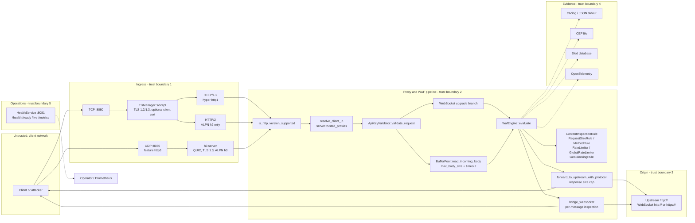

# Security Architecture and Threat Model

**Status:** Beta (`0.1.0-beta.8`), source-verified on 2026-10-31 against commit
`0cfd129`. This document describes the controls that are actually implemented in
the default Beta build. It is not a certification, a CRA conformity assessment
or a substitute for an operator's own risk analysis. Re-verify the code
references whenever the request path changes.

## 1. Scope and method

This model covers the `waf-ingress` binary: TLS/QUIC ingress, the HTTP proxy,
the WAF rule chain, WebSocket tunnelling, security-event export and the
health/metrics listener. It does not cover the upstream application, the
container runtime, Kubernetes, the operator's identity provider or the SIEM.

The analysis is bottom-up from the source. Each enforcement point below names
the function that implements it. Where a configuration key exists but is not
wired into the request path, that is called out explicitly rather than presented
as a control.

## 2. System context and trust boundaries

| Boundary | Crossing | Trust assumption | Primary control |
|---|---|---|---|
| TB1 | Client to ingress | Untrusted | TLS policy, HTTP version allowlist, auth, body limits |
| TB2 | Trusted proxy to WAF | Only listed CIDRs are trusted for forwarding headers | `resolve_client_ip` ignores `X-Forwarded-For`/`X-Real-IP` from other peers |
| TB3 | WAF to origin | Origin is trusted to serve its own content; it is not trusted to see forged client identity | Hop-by-hop and forwarding headers are stripped and rewritten |
| TB4 | WAF to evidence store | Local filesystem/database and SIEM collector are operator-controlled | Optional CEF/Sled/OTel exporters; export failures are logged, not blocking |
| TB5 | WAF to health/metrics | Operator network only | Separate listener; no authentication or TLS in the process |

Assets in scope: client credentials (API keys), request metadata and bodies,
client IP identity used for rate limiting and geo blocking, security events,
TLS private keys and upstream CA bundles, and the availability of the proxy
itself.

## 3. Request lifecycle and enforcement points

The order below is the order in the code, not an idealised order. The first
blocking decision wins.

| # | Stage | Implementation | Rejection |
|---|---|---|---|
| 1 | Accept TCP | `WafProxyService::start_with_listener` | — |
| 2 | TLS handshake | `TlsManager::accept`, `TlsManager::new` | handshake failure closes the connection |
| 3 | Protocol admission | `handle_connection`, `detect_http_version`, `is_http_version_supported` | `505` if the version is not in `server.supported_http_versions` |
| 4 | Client identity | `WafProxyService::resolve_client_ip` | — |
| 5 | Authentication | `ApiKeyValidator::validate_request` | `401` |
| 6a | WebSocket upgrade | `WebSocketHandler::is_websocket_upgrade`, `WafEngine::evaluate`, `proxy_websocket` | `501` for non-HTTP/1.1, WAF status otherwise |
| 6b | WebTransport | `WebTransportHandler::is_webtransport_request` | `501` when the `webtransport` feature is compiled |
| 7 | Body admission | `BufferPool::read_incoming_body` under `tokio::time::timeout` | `413` over `server.max_body_size`, `408` on timeout, `400` on read error |
| 8 | WAF evaluation | `WafEngine::evaluate` | `Decision::Block` or `Decision::RateLimit` |
| 9 | Traditional rules | `add_default_rules` order: content inspection, `RequestSizeRule`, `MethodRule`, `RateLimiter`, `GlobalRateLimiter`, `GeoBlockingRule` | first block wins; `413`, `405`, `429`, `403` |
| 10 | Upstream forward | `forward_to_upstream_with_protocol` | `502` on connect/read failure, `504` on timeout |
| 11 | Response cap | `Content-Length` pre-check plus `http_body_util::Limited` | `502` if over `server.max_body_size` |
| 12 | WebSocket data path | `bridge_websocket`, `websocket_message_blocked` | close both sides on a blocked or oversized message |
| 13 | HTTP/3 path | `http3::handle_request`, `read_body`, `send_response` | same status codes as HTTP/1.1 |

### 3.1 Transport and protocol admission

TLS is optional (`server.tls.enabled`). When enabled, `TlsManager::new` loads the
certificate and key, applies `server.tls.min_version`/`max_version` (1.2 and 1.3
only) and the configured ALPN list. Client certificates are optional; when
`server.tls.require_client_cert` is true, a client CA must be configured or
startup fails. HTTP/2 is served only when TLS ALPN negotiated `h2`; cleartext
HTTP/2 (h2c) is not offered. HTTP/1.1 is the plaintext default.

HTTP/3 is compiled only with the `http3` feature and starts only when
`server.enable_http3` is true, `"3"` is listed in
`server.supported_http_versions`, and TLS is enabled with a maximum version of
1.3. `TlsManager::quic_server_config` restricts ALPN to `h3`. If QUIC
configuration fails, `http3::serve` returns `Ok(())` without binding, so HTTP/3
silently degrades to TCP; the TCP listener is unaffected. HTTP/3 0-RTT is not
explicitly enabled (rustls leaves `max_early_data_size` at 0).

### 3.2 Client identity

`resolve_client_ip` treats the socket peer as authoritative unless the peer is
inside `server.trusted_proxies`. For a trusted peer it parses
`X-Forwarded-For`, walks the chain from the right, skips hops that are
themselves trusted proxies, and returns the first non-trusted hop. If every hop
is trusted it falls back to `X-Real-IP`, then to the peer address. Invalid CIDRs
are ignored at startup with a warning; `Config::validate` rejects them when
loading a config file.

The resolved address is the key for per-IP rate limiting and geo blocking and is
the value written to the origin as `X-Forwarded-For` and `X-Real-IP`. The
`X-Forwarded-Proto` value is derived from whether this listener terminated TLS,
not from an inbound header.

### 3.3 Authentication

`ApiKeyValidator::validate_request` runs before the body is read. It enforces:

- `security.auth.require_https` against the listener's TLS state (HTTP/3 always
  passes `true`); a plaintext listener with this enabled rejects every request;
- presence of `security.auth.header_name` (default `X-API-Key`);
- membership of the SHA-256 hash of the presented value in the in-memory set
  built by `InMemoryKeyStore::from_raw_keys`.

Keys are held in plaintext in configuration and hashed at startup; the
membership check is a normal `HashSet` lookup, not a constant-time comparison.
`AuthConfig::rate_limit` exists but is not enforced anywhere in the request
path, and failed authentication happens before the WAF rule chain, so invalid
keys are not rate limited by the proxy.

### 3.4 Body admission

`handle_request` derives a size hint from `Content-Length`, then calls
`BufferPool::read_incoming_body` with `Some(server.max_body_size)`. The limit is
enforced while streaming, including chunked bodies without a length. The whole
body is buffered in memory before inspection. A separate
`server.request_timeout_secs` timeout covers the read. `RequestSizeRule` later
checks the recorded body size again.

`proxy.max_request_size`, `proxy.timeout_seconds`, `server.max_connections` and
`server.keep_alive_timeout_secs` are present in configuration but are not wired
into the runtime; the upstream request and response-collection timeouts are
hard-coded to 30 seconds.

### 3.5 WAF evaluation and fail mode

`WafEngine::evaluate` is called for every non-WebSocket request, and directly
for WebSocket upgrades. In order:

1. If the WASM engine was configured but failed to initialise and
   `waf.fail_mode != "open"`, return `503` (fail-closed).
2. If the `wasm-waf` feature is compiled and enabled, run the WASM stage. A
   block or rate-limit decision returns immediately; an engine error returns
   `503` when fail-closed.
3. If the `ai-threat-detection` feature is compiled and enabled, run the AI
   stage with the same error handling.
4. Evaluate traditional rules in insertion order and stop at the first
   `Block` or `RateLimit`.

In the default Beta build neither `wasm-waf` nor `ai-threat-detection` is
compiled, and the bundled `rules/coraza.wasm` is not a Coraza/CRS engine.
Consequently `waf.fail_mode` has no observable effect in a default build:
traditional rules are synchronous and infallible. Fail-closed still matters for
custom builds that enable those features.

`waf.enabled` is also not consulted by the request path. Setting it to `false`
logs a startup warning but does not disable evaluation. Operators must remove
rules or not deploy the proxy if they need a pass-through.

### 3.6 Traditional rules

`ContentInspectionRule::evaluate` checks, in order:

- URI path longer than 8 KiB: block `414`;
- URI path against high-priority (High/Critical) patterns, raw and
  percent-decoded once;
- query string longer than 8 KiB: block `414`;
- query string against all patterns, raw and percent-decoded once;
- every header value against high-priority patterns that set `check_headers`
  (raw value only, no percent decoding);
- the full body (up to a 16 MiB hard cap) against all patterns that set
  `check_body`, using `String::from_utf8_lossy`, raw and percent-decoded once.

Patterns are Rust `regex` expressions, so matching is linear-time and not
vulnerable to catastrophic backtracking. Matched text is truncated to 100
characters for the reason string. `ContentInspectionConfig::inspect_headers`,
`inspect_body` and its `max_body_size` are not used when rules are constructed;
only `enabled` and `threat_patterns` take effect.

`RequestSizeRule` returns `413` over `server.max_body_size`. `MethodRule`
blocks `TRACE` and `CONNECT` with `405`. `RateLimiter` is a per-IP token bucket
keyed on the resolved client address; `GlobalRateLimiter` is one process-wide
bucket. Both return `RateLimit`, which the proxy renders as `429` with
`Retry-After: 60`. Expired per-IP buckets are removed on a probabilistic 1% of
evaluations, so the bucket map can grow between cleanups. `GeoBlockingRule`
looks up the resolved address and can block by country, region, Tor exit, VPN
or datacenter flag.

### 3.7 Upstream forwarding and response handling

`forward_to_upstream_with_protocol` rewrites the URI to
`proxy.upstream_url` plus the inbound path and query, preserves the client
`Host` for the origin (also copied to `X-Forwarded-Host`), strips `host`,
`connection`, `proxy-connection`, `upgrade`, `te`, `trailer`,
`transfer-encoding`, `keep-alive`, `x-forwarded-for`, `x-real-ip` and
`x-forwarded-proto`, then sets authoritative `X-Forwarded-For`, `X-Real-IP`,
`X-Forwarded-Proto` and `X-Waf-Proxy`. The client `Content-Length` is copied
while the body is re-framed from the buffered bytes; the proxy does not
independently reconcile the two.

The origin connector is a cleartext `HttpConnector`. Regular HTTP upstreams
therefore must be `http://`; `https://` origin support exists only for
WebSocket upstreams, where `proxy_websocket` uses rustls with `webpki-roots`
plus an optional PEM bundle from `proxy.upstream_ca_path`. Hostname and
certificate verification are not weakened.

Responses are read with `http_body_util::Limited` capped at
`server.max_body_size` (the same value is passed as `max_response_bytes`). A
declared `Content-Length` over the cap is rejected before reading; the
streaming limit catches undeclared or chunked responses. Hop-by-hop response
headers are dropped and `x-waf-processing-time-ms`, `x-waf-version` and
`x-content-type-options: nosniff` are added. The response body is **not**
inspected, normalised or decompressed.

### 3.8 WebSocket path

`is_websocket_upgrade` requires `Upgrade: websocket`, a `Connection` token
containing `upgrade`, `Sec-WebSocket-Version: 13` and a key. The upgrade request
is evaluated by the WAF with headers and URI but no body; non-HTTP/1.1 upgrades
are rejected with `501`. `proxy_websocket` opens a raw TCP or TLS connection to
the configured origin, writes a handshake assembled from the client's headers
(except `host`, `connection`, `upgrade`, `proxy-connection`,
`x-forwarded-host`), and requires a `101` response.

After the upgrade, `bridge_websocket` inspects each client `Text` or `Binary`
message through the full `WafEngine::evaluate` chain, including the rate
limiters, and closes both sides on a block. The tungstenite codec is configured
with `server.websocket.max_frame_bytes` and `max_message_bytes` (both default
to `server.max_body_size`), so an oversized frame or a fragmented message that
exceeds the message cap is rejected while reading, before the complete message
is assembled. The proxy closes both sides with a policy violation (`1008`).
The assembled message is still re-checked against `max_message_bytes` and the
WAF as defence in depth. Control frames are passed through, upstream-to-client
messages are not inspected, and there is no idle timeout on the tunnel.
`permessage-deflate` is not configured in the proxy's tungstenite codec, while
client extension headers are forwarded to the origin.

### 3.9 HTTP/3 path

`http3::handle_request` reconstructs the URI from pseudo-headers (falling back
to `Host` and `https`), derives a `Host` header when absent, forces the
outbound version to HTTP/1.1 for the shared client, applies the HTTP-version
allowlist, resolves the client IP with the same trusted-proxy logic, runs
authentication with `is_https = true`, reads the body with the same streaming
cap and timeout, and calls the same `WafEngine::evaluate` and
`forward_to_upstream_with_protocol`. `send_response` strips connection-specific
headers. There is no WebSocket/WebTransport branch on HTTP/3.

Before a resolver is spawned, `h3_admission` acquires a global permit
(`server.h3_max_inflight_requests`, default `256`) and, when configured, a
per-client permit (`server.h3_max_inflight_per_client`). Saturation waits up to
`server.h3_admission_timeout_ms` and then returns `503` with `Retry-After`;
the per-client cap returns `429`. Admission happens before `resolve_request`
and before any body read, so excess work cannot allocate a handler or body
buffer. Permits are RAII guards and are released when the handler finishes,
panics or is cancelled; listener shutdown closes the semaphore so waiters fail
immediately.

## 4. Bypass classes

The entries below describe attacks that are relevant to this proxy. "Current
control" is what the Beta actually does; "residual" is what remains.

### 4.1 Spoofed `X-Forwarded-For` / `X-Real-IP`

**Attack:** forge a client address to evade per-IP rate limits, geo blocking or
origin ACLs, or to poison audit evidence.

**Current control:** `resolve_client_ip` ignores forwarding headers from peers
outside `server.trusted_proxies`, and for trusted peers walks the chain from the
right, skipping trusted hops. Forwarding headers are removed before the origin
request and replaced with the resolved address.

**Residual:** the control is only as good as the CIDR list. A broad entry such
as `0.0.0.0/0` makes every peer trusted and every header spoofable. If all
supplied hops are trusted, the code accepts `X-Real-IP` from that trusted peer.
The WebSocket handshake does not strip `X-Forwarded-For`, `X-Real-IP` or
`X-Forwarded-Proto`, so the WebSocket origin sees client-supplied values while
the HTTP origin does not. `X-Forwarded-Proto` sent to HTTP origins reflects the
listener, not a trusted edge.

### 4.2 Encoded payloads

**Attack:** evade regex rules with percent encoding, double encoding, `+` for
space, Unicode/overlong UTF-8, HTML entities, JSON escapes, base64 or
compression.

**Current control:** URI, query and body are checked raw and after one
`urlencoding::decode` pass (`percent_decode`). The body is checked in full, not
just the first megabyte. `ContentInspectionRule` deliberately always runs the
regex engine; SIMD helpers are not allowed to declare content safe.

**Residual:** only one decoding layer is applied. Nested encodings, UTF-16,
overlong UTF-8, entity/escape decoding, base64 and compressed bodies are not
normalised. Header values are not percent-decoded at all and are only checked
against high-priority patterns. The rule set is heuristic and small compared
with CRS; it is not an anomaly-scoring engine.

### 4.3 Overlong URI, headers and body

**Attack:** pad a URI, query, header set or body so a payload falls outside the
inspected window, or exhaust memory.

**Current control:** path and query over 8 KiB return `414`; body over 16 MiB in
the inspection rule returns `413`; the proxy streams and rejects bodies over
`server.max_body_size` (default 10 MiB) before inspection. Header count and
header-section size are bounded by hyper defaults, not by configuration.

**Residual:** there is no operator-tunable header-size, header-count or
query-parameter-count limit. The whole body is buffered in memory, and
`server.max_connections` is not enforced, so concurrent large uploads can
exhaust memory. `ContentInspectionConfig.max_body_size` is not the effective
limit; `server.max_body_size` is.

### 4.4 WebSocket frames

**Attack:** hide a payload in a frame, a fragmented message, a compressed
frame, a control frame or the server-to-client direction; or hold a tunnel open
to exhaust resources.

**Current control:** text and binary messages are evaluated with the full rule
chain; the tungstenite parser enforces `server.websocket.max_frame_bytes` and
`max_message_bytes` while reading, so oversized frames and fragmented messages
are rejected before assembly; blocked messages close both sides. Fragmented
messages within the cap are reassembled by tungstenite before inspection.

**Residual:** control frames and upstream-to-client traffic are not inspected.
Compression is not negotiated by the proxy's codec, but client extension
headers are forwarded, so an origin may accept an extension the proxy cannot
decode. There is no idle or total-lifetime timeout, no per-connection frame
budget beyond the rate limiter, and no cap on concurrent tunnels. Each frame
consumes a rate-limit token and can produce a security event.

### 4.5 HTTP/3

**Attack:** use QUIC to reach a path with weaker controls, spoof UDP sources,
open many streams, or force a downgrade.

**Current control:** HTTP/3 reuses the same auth, body-limit, WAF and response
cap code. QUIC requires TLS 1.3 and ALPN `h3`; 0-RTT is not enabled.

**Residual:** HTTP/3 is feature-gated and silently does not start if QUIC
configuration fails, which can cause an unintended protocol downgrade. The
endpoint does not call `Incoming::retry()`, so there is no stateless address
validation before handshake state is allocated (QUIC anti-amplification limits
still apply). There is no cap on concurrent QUIC connections or request
streams. WebSocket-over-HTTP/3 (extended `CONNECT`) and WebTransport are not
implemented.

### 4.6 Decompression and transfer encoding

**Attack:** send a gzip/br/deflate request body so the WAF sees opaque bytes, or
exploit framing differences between the proxy and the origin.

**Current control:** hyper decodes chunked transfer encoding into body frames;
`transfer-encoding`, `te`, `trailer` and `connection` are stripped before
forwarding; the body is fully buffered and re-framed from `Bytes`.

**Residual:** `Content-Encoding` is never decoded. A compressed request body is
inspected as compressed bytes, so content rules can be bypassed. The client
`Content-Length` header is copied without reconciliation against the buffered
body. There is no dedicated request-smuggling detector; the design relies on a
single hyper HTTP/1.1 parser, full buffering, and hop-by-hop stripping.

### 4.7 Request smuggling

**Attack:** desynchronise the proxy and origin with conflicting
`Content-Length`/`Transfer-Encoding`, obfuscated headers, or HTTP/2-to-HTTP/1.1
conversion differences.

**Current control:** one HTTP/1.1 parser (hyper) on ingress, full body
buffering, `Transfer-Encoding` removed on the outbound request, and hop-by-hop
headers dropped in both directions.

**Residual:** the proxy does not reject ambiguous framing itself, does not
normalise duplicate `Content-Length` headers, and copies the client
`Content-Length` while re-framing. The origin must use a conformant parser and
must not be reachable except through the proxy. No CRS-style smuggling rules
exist.

### 4.8 Upstream response abuse

**Attack:** a compromised or malicious origin returns an oversized body, a
header flood, a redirect to an attacker, malicious `Set-Cookie`, or content
that attacks the client through the trusted proxy origin.

**Current control:** response bodies are capped at `server.max_body_size` with
a `Content-Length` pre-check and a streaming `Limited`; hop-by-hop response
headers are removed; `nosniff` is added.

**Residual:** response bodies and headers are not inspected, sanitised,
decompressed or filtered. There is no response-side DLP, malware scan, CSP
injection or cookie policy. The origin can serve any content through the WAF.
Response header size is bounded only by hyper defaults.

### 4.9 Rate-limit and authentication evasion

**Attack:** rotate source addresses, distribute across a botnet, abuse IPv6
prefixes, or brute-force API keys.

**Current control:** per-IP and global token buckets; authentication is a
startup-loaded hash set.

**Residual:** rate limits are per process, not shared across replicas, and are
keyed on the resolved IP. IPv6 rotation and distributed sources defeat per-IP
limits. Bucket cleanup is probabilistic and the bucket map is unbounded between
cleanups. Failed authentication is not rate limited because auth runs before
the rule chain. API keys are shared secrets with no per-key quota, rotation API,
expiry or replay protection.

### 4.10 Error-path and observability issues

- `create_blocked_response` puts the block reason, including up to 100
  characters of matched payload, into the `x-waf-reason` response header. A
  match containing a control character can make header construction fail; the
  current code unwraps the response builder, which can panic the connection
  task.
- `x-waf-supported-protocols` advertises HTTP/3 even in builds without the
  `http3` feature.
- Security events hard-code `http_version` to `"1.1"`, set `response_status` to
  `200` for allowed requests without observing the origin, and leave
  `response_size`, `processing_time_ms`, `client_port` and all geo fields
  unset.
- `waf.security_events.enabled` is not checked by `SecurityEventLogger`; only
  the minimum threat level filters events.

## 5. Explicit non-goals and residual risks

The following are **not implemented** in Beta and must not be assumed:

- **Coraza/ModSecurity/OWASP CRS.** The WASM runtime is not compiled into the
  default build. The bundled `rules/coraza.wasm` is a Go-JS demo module, not a
  Coraza engine. See [`../wasm-integration-status.md`](../wasm-integration-status.md).
- **WebTransport.** Requests are rejected with `501` only when the
  `webtransport` feature is compiled; otherwise they are treated as ordinary
  HTTP. See [`../webtransport-plan.md`](../webtransport-plan.md).
- **TLS to regular HTTP upstreams.** Only WebSocket upstreams support `https://`.
  There is no upstream mTLS, no custom CA for plain HTTP forwarding, and no
  upstream certificate pinning.
- **Response inspection and DLP.** No data-loss prevention, PII detection,
  malware scanning, file-upload inspection, response body filtering or
  content-disposition policy.
- **Bot management and challenge.** `WafDecision::Challenge` exists in the event
  model but the request path never produces a challenge; there is no CAPTCHA,
  proof-of-work or JS challenge.
- **GeoIP data quality.** Without a MaxMind City database only two built-in
  test addresses resolve (`8.8.8.8` and `192.0.2.1`). Unknown addresses get
  `XX`; ASN fields are always `0`/`Unknown` on the database path; Tor/VPN/
  datacenter flags need a separate Anonymous IP database. A missing database is
  logged but not fatal, and an allow-only country list without a database
  blocks every request unless `XX` is explicitly allowed.
- **Distributed state.** Rate limits, geo cache and event storage are local to
  one process. There is no Redis/cluster coordination.
- **Config hot reload.** Certificates, keys, rules and API keys are loaded at
  startup; only the unused WASM hot-reload option exists.
- **PROXY protocol, SNI routing and multi-tenancy.** Not supported; one upstream
  per process.
- **Audit integrity.** Events are best-effort. Exporters are created with
  `fail_fast = false`; an export failure is logged and the request continues.
  There is no signing, hash chain, WORM storage or guaranteed delivery.
- **HTTP/0.9, h2c and extended CONNECT.** Not offered.
- **Header and query normalisation.** No duplicate-header rejection, no
  `Host` canonicalisation, no query reordering.

## 6. Deployment assumptions

The model holds only if the operator satisfies these assumptions:

1. The origin is reachable only through the WAF (network policy, security
   group, or private network). A direct path bypasses every control here.
2. TLS is terminated either in the WAF or in a trusted load balancer whose
   exact CIDRs are in `server.trusted_proxies`. If TLS terminates at the LB and
   `security.auth.require_https` is true, authentication will reject every
   request because the WAF listener is plaintext.
3. The health/metrics listener (`server.health_bind_addr`, default
   `0.0.0.0:8081`) is bound to a private interface or blocked by firewall and
   network policy. It has no authentication, no TLS and no rate limiting.
4. `server.trusted_proxies` is the minimum set of proxy CIDRs, never
   `0.0.0.0/0` or `::/0` unless the entire network is trusted.
5. Configuration and API keys are mounted as secrets, not baked into the image
   or committed. The config file is readable only by the service account.
6. The process runs as a non-root user with a read-only root filesystem except
   for the Sled/CEF paths, and has CPU/memory limits sized for
   `max_body_size × expected concurrency`.
7. MaxMind databases, if used, are licensed, mounted read-only and refreshed on
   a schedule; their absence is treated as a configuration error by monitoring.
8. Logs and events are shipped to a SIEM with retention that meets the
   operator's regulatory obligations; local disk is not the only copy.
9. The origin treats `X-Forwarded-*` and `Host` as untrusted input and does not
   use them for tenant isolation or authorization without its own validation.
10. HTTP/3, if enabled, has UDP reachability, TLS 1.3 certificates, and a
    monitoring check that the QUIC listener actually started.

## 7. Hardening checklist

- [ ] Enable TLS (`server.tls.enabled = true`), set `min_version = "1.2"` or
      `"1.3"`, and load a valid certificate chain.
- [ ] Enable API-key authentication and keep `require_https = true` when the
      WAF terminates TLS; set it to `false` only behind a trusted TLS LB.
- [ ] Generate high-entropy API keys, store them in a secret manager, and rotate
      them by redeploying (there is no rotation API).
- [ ] Restrict `server.trusted_proxies` to exact LB/proxy CIDRs and verify with
      a request that a forged `X-Forwarded-For` is ignored.
- [ ] Set `server.max_body_size` to the smallest value the application needs;
      remember it also caps upstream responses.
- [ ] Set `server.request_timeout_secs` and ensure the origin has its own
      timeouts; the 30-second upstream timeout is not configurable.
- [ ] Tune `waf.rate_limit.per_ip_*` and `global_*`; add an edge/WAF-level
      limiter if the service is horizontally scaled.
- [ ] Keep `waf.fail_mode = "closed"` for builds with WASM or AI stages.
- [ ] Do not rely on `waf.enabled = false`; remove rules or do not deploy the
      proxy if pass-through is required.
- [ ] Enable JSON security events and ship them to the SIEM; set
      `min_threat_level` deliberately (default `medium` suppresses allowed
      requests).
- [ ] If persistence is required, enable the Sled exporter with an explicit
      path, size cap and backup/retention policy.
- [ ] Bind the health listener to loopback or a private interface; scrape it
      over an authenticated internal network.
- [ ] Mount GeoIP databases read-only, refresh them, and alert when they are
      missing or stale.
- [ ] Add a network policy that prevents direct access to the origin.
- [ ] Run as non-root, drop capabilities, use a read-only root filesystem and
      set memory/CPU limits.
- [ ] Monitor `waf_blocked_total`, `waf_upstream_errors_total`, 5xx/429 rates,
      TLS handshake failures and QUIC listener startup.
- [ ] Re-run the bypass tests in section 4 after any change to the request
      path, and re-verify the code references in this document.

## 8. Incident and audit evidence

| Source | What it contains | Where it goes | Limitations |
|---|---|---|---|
| Security events (`SecurityEventLogger::log_event`) | UUID, UTC timestamp, resolved client IP, method, path, user agent, decision, threat level, triggered rule names, request size, referer, inbound `X-Forwarded-For`, block reason | tracing JSON on stdout, then optional CEF/Sled/OTel | No response body/size, no processing time, no client port, `http_version` hard-coded `1.1`, geo fields empty; allowed events filtered at default `medium` |
| Application logs (`tracing`) | Startup configuration summary, block reasons with rule names, auth failures, upstream errors, TLS handshake failures | stdout/stderr, collected by the platform | No request correlation ID; log level controls detail; payload fragments can appear in block reasons |
| CEF exporter (`CefExporter`) | CEF v1 lines with decision, severity and event fields | `waf.security_events.cef_output_file` | Optional, append-only; rotation is the operator's responsibility; export failure is logged but not retried durably |
| Sled exporter (`SledExporter`) | Serialised `SecurityEvent` records | `waf.security_events.sled_db_path` (default `./waf_security_events.sled`) | Optional; local; `sled_max_events` bounds retention; no encryption at rest by the application |
| OpenTelemetry exporter | Traces/logs for events | OTLP endpoint configured by the operator | Feature-gated; not a durable audit store |
| Prometheus metrics (`Metrics::render_prometheus`) | `waf_requests_total`, `waf_allowed_total`, `waf_blocked_total`, `waf_upstream_errors_total`, `waf_uptime_seconds` | `/metrics` on the health listener | Aggregate counters only; no per-rule, per-country or latency labels |
| Health endpoints (`HealthService::handle_health_request`) | Static component status, version, uptime | `/health`, `/ready`, `/live` | Component status is hard-coded healthy; not a dependency check |

For an incident, preserve: the stdout log window, the CEF file or Sled database
snapshot, the Prometheus range query, the deployed config (redacted), the
container image digest, the SBOM and the release attestation. The WAF does not
record packet captures, TLS secrets, full request bodies or response bodies;
do not expect them from this component.

## 9. Code map

| File | Functions | Role |
|---|---|---|
| `src/proxy/service.rs` | `WafProxyService::start_with_listener`, `handle_connection`, `handle_request`, `resolve_client_ip`, `forward_to_upstream_with_protocol`, `proxy_websocket`, `bridge_websocket`, `websocket_message_blocked`, `create_blocked_response` | Ingress, pipeline order, header rewriting, response cap, WebSocket tunnel |
| `src/proxy/http3.rs` | `serve`, `handle_connection`, `handle_request`, `read_body`, `send_response`, `reconstruct_uri` | QUIC ingress reusing the same pipeline |
| `src/proxy/buffer_pool.rs` | `BufferPool::read_incoming_body` | Streaming body limit and buffering |
| `src/waf/mod.rs` | `WafEngine::with_config`, `add_default_rules`, `evaluate` | Rule construction, fail mode, WASM/AI/traditional order |
| `src/waf/content_inspection.rs` | `ContentInspectionRule::evaluate`, `check_with_decoding`, `inspect_body`, `percent_decode`, `limited_match_text` | URI/query/header/body pattern matching |
| `src/waf/rules.rs` | `RequestSizeRule::evaluate`, `MethodRule::evaluate` | Body-size and method enforcement |
| `src/waf/auth.rs` | `ApiKeyValidator::validate_request`, `InMemoryKeyStore::from_raw_keys`, `hash_key` | API-key authentication and HTTPS requirement |
| `src/waf/rate_limit.rs` | `TokenBucket::try_consume`, `RateLimiter::evaluate`, `GlobalRateLimiter::evaluate` | Per-IP and global token buckets |
| `src/waf/geoip.rs` | `GeoIpService::from_database`, `lookup`, `GeoBlockingRule::evaluate` | MaxMind lookup and geo/anonymity blocking |
| `src/waf/tls_config.rs` | `TlsManager::new`, `accept`, `quic_server_config` | TLS versions, ALPN, client certs, QUIC TLS 1.3 |
| `src/waf/security_events.rs` | `SecurityEventLogger::log_event`, `create_security_event`, `should_log_event` | Event construction and filtering |
| `src/waf/exporters/*` | `ExporterDispatcher`, `CefExporter`, `SledExporter`, `OpenTelemetryExporter` | Evidence export |
| `src/health.rs` | `HealthService::start`, `handle_health_request` | Health, readiness, liveness and metrics listener |
| `src/metrics.rs` | `Metrics::render_prometheus` | Prometheus counters |
| `src/config.rs` | `Config::load`, `Config::validate`, `WafConfig`, `ServerConfig`, `SecurityEventsConfig` | Configuration and startup validation |

## 10. Review and change control

This model is part of the documentation set, not a runtime control. Update it
when any of the following change: the request pipeline order, a new protocol
listener, authentication or authorization, body/response limits, the rule set,
exporters, or the health surface. Changes that alter a trust boundary or add a
new bypass class require a security review before merge.

Related documents:

- [`../../SECURITY.md`](../../SECURITY.md) — disclosure and support policy.
- [`../operations/deployment.md`](../operations/deployment.md) — deployment
  guide.
- [`../operations/monitoring.md`](../operations/monitoring.md) — metrics and
  alerting.
- [`../wasm-integration-status.md`](../wasm-integration-status.md) — Coraza/WASM
  status.
- [`../webtransport-plan.md`](../webtransport-plan.md) — WebTransport plan.
