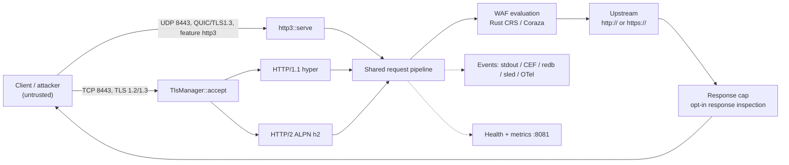

# Penetration-Test Readiness Pack

**Status:** ready for external engagement. This pack is the entry point; it is
not a security certification and it does not replace an operator's risk
analysis.

| Item | Value |
|---|---|
| Product | WAF-Rejected (`waf-ingress`) |
| Version under test | `0.1.0-beta.16` |
| Commit under test | `0c3290b4eb078206b5a03a3f1f709d0769ff0918` |
| Branch carrying this pack | `docs/pen-test-readiness` |
| Pack written | 2026-11-13 |
| Security model baseline | [`docs/architecture/security-model.md`](../architecture/security-model.md), source-verified at `563541b` |
| Default inspection backend | Native Rust CRS engine (`waf.coraza.backend = "rust"`, 505 CRS 4.14 rules) |
| Reference backend / oracle | Coraza 3.8.1 WASI reactor (`backend = "wasm"`) |
| Baseline config | [`config/pentest.toml`](../../config/pentest.toml) |

**How to use this pack.** Sections 1–4 define the target and the boundary.
Section 5 maps abuse cases to controls and to a test. Section 6 is the test
plan with concrete procedures and expected results. Section 7 stands the target
up. Section 8 lists things that are known and must not be re-reported as new
findings. Section 9 is the reporting and remediation process.

Everything here is derived from the source at the commit above and from the
security model. Where the code and the security model disagree, this pack says
so in-line and the disagreement is listed in section 8.4 rather than smoothed
over.

---

## 1. System description

### 1.1 What the WAF is

WAF-Rejected is a single-process, asynchronous reverse proxy that inspects HTTP
traffic before forwarding it to one upstream. It is written in Rust, built with
Nix, and shipped as the `waf-ingress` binary and a container image.

It provides:

- TLS 1.2/1.3 termination with optional client certificates and ALPN `h2`;
  HTTP/1.1, HTTP/2 and (feature-gated) HTTP/3 ingress.
- Request framing validation (CL/TE ambiguity rejection) before any body read,
  on HTTP/1.1, HTTP/2 and HTTP/3.
- Bounded request decompression (`gzip`, `deflate`, `br`, one coding).
- API-key authentication with per-key/per-IP/global throttles, optional
  expiry/rotation, and an opt-in pre-validation failure budget with lockout.
- A native Rust CRS engine (default) and the Coraza 3.8.1 WASI reactor
  (reference/oracle); an opt-in native Coraza sidecar.
- Per-IP and global token-bucket rate limiting, heavy-inspection admission
  control, connection/stream caps, header bounds and body caps.
- WebSocket upgrade proxying with per-message inspection, RFC 6455 control-frame
  validation and tunnel limits.
- gRPC unary/streaming classification and per-message inspection.
- Optional geographic/anonymity blocking from MaxMind databases.
- Security-event export to stdout, CEF, redb (default) or legacy sled, and
  optional OpenTelemetry.
- A separate health/metrics listener with `/health`, `/health/ready`,
  `/health/live` and `/metrics`.
- An optional distributed client that consumes policy/lease data from a
  distri-kv cluster.

### 1.2 What it does not do (non-goals)

These are design boundaries, not bugs. Reporting them as vulnerabilities will
be closed as out of scope (see section 8):

- It is not an origin application firewall replacement and does not fix
  vulnerabilities in the upstream.
- It is not a DLP, malware scanner, file-upload scanner or antivirus engine.
- It does not issue bot challenges, CAPTCHAs or proof-of-work.
- It does not normalise or decode arbitrary encodings recursively (one
  percent-decode pass; one content coding).
- It does not inspect TLS-encrypted upstream traffic; it does not terminate and
  re-originate upstream TLS with a private CA.
- It does not authenticate or encrypt its health/metrics listener.
- It does not provide distributed rate limiting, shared caches or consensus;
  state is local to one process unless the optional distributed client is
  explicitly enabled.
- It does not provide signed, hash-chained or WORM audit storage.
- It does not proxy WebTransport sessions upstream (the endpoint terminates and
  echoes); WebSocket-over-HTTP/3 is not implemented.
- It is not certified, CRA-conformant or CE-marked.

### 1.3 Deployment shapes it is designed for

1. **TLS-terminating ingress (baseline).** The WAF binds TCP `:8443`, terminates
   TLS, runs the full pipeline and forwards plaintext HTTP to one upstream.
   This is the shape the baseline config and this pack use.
2. **Plaintext behind a trusted TLS load balancer.** The LB terminates TLS,
   forwards to the WAF, and the LB's exact CIDRs are in
   `server.trusted_proxies`. `security.auth.require_https` must be `false`,
   otherwise every request is rejected.
3. **Container / Kubernetes gateway or sidecar.** The published image runs the
   same binary with a mounted TOML config; Helm/Kubernetes manifests are in
   `infrastructure/`.
4. **Feature-gated HTTP/3 ingress.** UDP `:8443` with TLS 1.3 and ALPN `h3`;
   the TCP listener is unaffected if QUIC fails to start.
5. **Distributed client.** The WAF consumes policy/lease data from an external
   distri-kv cluster over gRPC or QuicCrunch with mTLS. The distri-kv server is
   out of scope.

One upstream per process; there is no SNI routing, PROXY protocol or
multi-tenancy.

### 1.4 Exact version and build under test

- Package version: `0.1.0-beta.16` (`Cargo.toml`).
- Commit: `0c3290b4eb078206b5a03a3f1f709d0769ff0918`.
- Default feature set: `rust-engine`, `wasm-reactor`, `export-system`
  (which implies `export-sled`), `export-redb`, `websocket`.
- HTTP/3 is **not** in the default build. If HTTP/3 or WebTransport is in the
  engagement, build with `--features http3` and/or `--features webtransport`
  and record the exact feature list in the report.
- Optional features that change the target: `coraza-native` (native sidecar
  backend), `distri-kv` (distributed client), `io-uring`, and the quarantined
  `experimental` / `compliance` / `enterprise-proto` sets (out of scope).

Record in the report the output of:

```bash
git rev-parse HEAD
./target/release/waf-ingress --version
curl -s http://127.0.0.1:8081/health | jq -r '.version'
```

If any of those differ from the table above, the engagement is testing a
different target and results are not comparable.

### 1.5 Feature boundary

The review boundary is defined in
[`docs/operations/module-scope.md`](../operations/module-scope.md). The default
build is the security boundary. Anything behind `experimental`, `compliance` or
`enterprise-proto` is quarantined: no release testing, no security review, no
compatibility guarantee. See section 4.

---

## 2. Trust boundaries and data flow

### 2.1 Data flow



### 2.2 Boundaries

| ID | Crossing | Trusted? | Control |
|---|---|---|---|
| TB1 | Client → ingress (TCP/UDP) | Untrusted | TLS policy, HTTP-version allowlist, header bounds, framing validation, auth, body/decompression caps, rate limits |
| TB2 | Trusted proxy/LB → WAF forwarding headers | Only listed CIDRs | `resolve_client_ip` ignores forwarding headers from other peers; for trusted peers every header line is combined and walked right-to-left |
| TB3 | WAF → origin | Origin is trusted for its own content, not for client identity | Hop-by-hop/routing headers stripped; `X-Forwarded-*` rewritten from trusted state |
| TB4 | WAF → evidence store | Operator-controlled local filesystem/SIEM | Optional exporters; failures are logged, not request-blocking; redb `Durability::Immediate` |
| TB5 | WAF → health/metrics listener | Operator network | Separate listener, no auth/TLS/rate limit |

### 2.3 Pipeline order (as implemented)

The order below is the order in the code; the first blocking decision wins. All
references are in `src/proxy/service.rs` unless stated.

| # | Stage | Enforcement | Rejection |
|---|---|---|---|
| 1 | Header bounds | `enforce_header_bounds` | generic `431` |
| 2 | HTTP version detect + allowlist | `detect_http_version`, `is_http_version_supported` | `505` |
| 3 | Client identity | `resolve_client_ip_with_metrics` | falls back to socket peer |
| 4 | Routing/override header handling | `HeaderStripPolicy` (strip, or reject when `proxy.reject_ambiguous_routing = true`) | `400` in reject mode |
| 5 | Request framing | `read_request_head` + `validate_request_head` on the literal wire head, then `validate_request_framing_for_version` after hyper parsing | generic `400` before any body read; CL+TE, duplicate `Content-Length`, invalid/stacked `Transfer-Encoding`, absolute-form targets and whitespace before a colon are rejected before hyper normalises them (section 8.4 item 1) |
| 6 | Authentication | `ApiKeyValidator::validate_request_for_client`: failure budget → key digest → auth rate limits | `401` / `429` |
| 7a | WebSocket upgrade branch | `is_websocket_upgrade`, `WafEngine::evaluate`, `proxy_websocket` | `501` non-HTTP/1.1, `400` bad handshake/body, WAF status |
| 7b | WebTransport (separate UDP listener) | `webtransport::serve` | `403`/`429`; `401` session close |
| 8 | gRPC classification | `classify_request`, `probe_grpc_body`, `handle_grpc_stream` | `400`/`413`, gRPC status |
| 9 | Body admission | `BufferPool::read_incoming_body` + timeout | `413` over cap, `408` timeout, `400` read error |
| 10 | Decompression | `decompress_request_body` | `415` unsupported/stacked, `413` expanded over cap, `400` malformed |
| 11 | WAF admission | `AdmissionController::admit` (inside `evaluate`) | `503 + Retry-After`, never silent allow |
| 12 | WAF evaluation | `WafEngine::evaluate`: GraphQL/gRPC pre-checks → engine rule → content/size/method/rate/geo | `403`/`413`/`405`/`429` |
| 13 | Upstream forward | `forward_to_upstream_with_protocol` | `502` / `504` |
| 14 | Response cap + opt-in inspection | `Limited`/`GuardedBody`, `inspect_upstream_response` | `502` over cap; `block_status` on inspection block |
| 15 | WebSocket data path | `bridge_websocket`, `websocket_message_blocked` | close both sides |
| 16 | HTTP/3 path | `src/proxy/http3.rs` | same statuses as HTTP/1.1 |

> **Order note.** The engagement brief described the order as
> “framing → header bounds → admission → auth failure budget → key validation →
> rate limit → inspection → upstream”. The code runs header bounds **before**
> framing, and body admission **after** authentication; WAF admission is inside
> `evaluate`. This pack uses the implemented order. The difference is material
> for tests that try to make the WAF parse a body before authenticating.

### 2.4 What is trusted and what is not

Trusted (operator-controlled, outside attacker reach if deployment assumptions
hold):

- The TOML configuration (including `upstream_uri`, limits, rule toggles).
- API keys at rest in configuration; hashed at startup.
- MaxMind City/Anonymous IP databases.
- Upstream CA bundles and client certificates.
- The event store path and SIEM collector.
- The health/metrics network.
- The origin's response content (trusted to be its own content, not to be safe
  for clients).

Untrusted (everything from the client):

- Request line, method, path, query, headers, body, trailers.
- `Content-Length`, `Transfer-Encoding`, `Host`, all `X-Forwarded-*`,
  `Forwarded`, `X-Real-IP`, `X-Client-IP`, routing/override headers.
- WebSocket handshake headers and every frame after the upgrade.
- gRPC method names, frames, compression flags and field contents.
- TLS ClientHello contents (SNI, ALPN, versions, client cert if presented).
- QUIC connection IDs, stream framing and transport parameters.
- Anything arriving on the health/metrics listener if it is reachable.

The origin is **not** trusted to enforce client identity. It is trusted to
serve its own content; response inspection is an opt-in control, not a
guarantee.

---

## 3. In-scope components

| Component | Files | What the tester may attack |
|---|---|---|
| Proxy request path / pipeline | `src/proxy/service.rs` (`handle_connection`, `handle_request`, `forward_to_upstream_with_protocol`, `create_blocked_response`) | Ordering, status mapping, routing-header handling, response caps, error paths |
| Framing / smuggling validation | `src/proxy/framing.rs` (`validate_request_framing`); call sites in `service.rs`, `http3.rs` | CL/TE variants, duplicate lengths, whitespace, protocol conversion |
| Body admission / buffering | `src/proxy/buffer_pool.rs` (`read_incoming_body`) | Streaming caps, chunked bodies without length, read timeouts |
| Decompression | `src/proxy/decompression.rs` (`decompress_request_body`, `strip_encoding_headers`) | gzip/deflate/br bombs, stacked codings, malformed streams, header rewriting |
| Native CRS engine | `src/waf/rust_engine/`; selection in `src/waf/mod.rs` | Rule coverage, transforms, fail-closed behaviour, payload caps |
| Coraza WASI reference path | `src/waf/wasm_reactor.rs`; `waf.coraza.backend = "wasm"` | Differential behaviour vs the Rust engine, reactor limits/timeouts |
| Native Coraza sidecar (opt-in) | `src/waf/native_coraza.rs`; `native/coraza-sidecar/` | Only if built with `coraza-native` and a sidecar is running |
| Content inspection | `src/waf/content_inspection.rs` | One-pass percent decoding, header/body coverage, 8 KiB URI/query caps |
| Auth | `src/waf/auth.rs` (`ApiKeyValidator`, `AuthRateLimiter`, `InMemoryKeyStore`) | Missing/invalid/expired keys, lockout, throttles, HTTPS requirement |
| Rate limiting | `src/waf/rate_limit.rs` (`RateLimiter`, `GlobalRateLimiter`, `CapacityPolicy`) | Boundary behaviour, shard independence, table capacity |
| Admission control | `src/waf/admission.rs` | Saturation, queue timeout, 503 + `Retry-After`, no silent allow |
| WebSocket | `src/proxy/service.rs` (`proxy_websocket`, `bridge_websocket`, `websocket_control_violation`), `src/proxy/websocket.rs` | Handshake, extensions, control frames, fragmentation, caps, response direction |
| gRPC | `src/proxy/grpc_body.rs`, `src/waf/grpc.rs` | Frame lengths, streaming classification, gzip expansion, trailers, allowlist |
| GraphQL | `src/waf/graphql.rs` | `crs` / `graphql-only` / `off`, allowlists, depth/alias limits |
| HTTP/3 | `src/proxy/http3.rs` (`serve`, `handle_request`, `read_body`) | Reuse of the same pipeline, connection/stream caps, stateless retry, silent-degrade behaviour |
| WebTransport (feature-gated) | `src/proxy/webtransport.rs` | Origin/path/auth checks, session/stream caps, inspection, echo-only behaviour |
| Event export / storage | `src/waf/security_events.rs`; `src/waf/exporters/*` (CEF, redb, sled, OTel) | Event fidelity, filtering, retention, tamper visibility, export failure behaviour |
| Health / metrics | `src/health.rs`, `src/metrics.rs` | `/health`, `/health/ready`, `/health/live`, `/metrics`, readiness reasons |
| Distributed client (opt-in) | `src/waf/distributed/*`; `waf.distributed` config | Policy/lease handling, `local_only` fallback, cache invalidation, mTLS |
| TLS / QUIC | `src/waf/tls_config.rs` | Version admission, ALPN, client certs, upstream verification |

---

## 4. Out of scope

| Excluded | Reason |
|---|---|
| Quarantined experimental modules (`experimental`): legacy AI/ML heuristics, ModSecurity scaffolding, engine kernel, fast path, allow cache, CRS prefilter, io_uring prototype, ad-hoc test servers | Outside the security boundary by policy; no release testing or review ([module-scope](../operations/module-scope.md)) |
| Compliance / enterprise evidence tooling (`compliance`, `enterprise-proto`) | Quarantined; evidence generators, not runtime controls |
| Legacy `wasm-waf` component-ABI stage and the bundled `rules/coraza.wasm` demo | Not the Coraza engine; non-default and experimental |
| Native Coraza sidecar unless explicitly built and running | Non-default feature; the sidecar process itself is a separate trust domain |
| The distri-kv server, Raft consensus, its storage and its admin surface | Separate product; only the WAF's client seam is in scope |
| Operator infrastructure: Kubernetes, load balancer, identity provider, SIEM, MaxMind licensing, OS, container runtime, network policy | Deployment responsibility |
| The upstream application and its business logic | Not part of the WAF |
| Findings that require a deliberately insecure configuration (auth disabled, `trusted_proxies = 0.0.0.0/0`, health listener exposed publicly) | Documented deployment assumptions; report as configuration risk, not a product vulnerability |
| WebTransport upstream proxying | Not implemented; the endpoint terminates and echoes |
| Response DLP, malware scanning, CSP injection, cookie policy | Not implemented |
| `rules/coraza.wasm` CRS coverage | Demo module; the live reference is the WASI reactor |

---

## 5. Threat model: abuse cases mapped to controls

Status vocabulary: **T** = automated test exists in this repository;
**U** = implemented but unverified by an automated test (design intent);
**N** = not implemented / no control. “Test” is the case ID in section 6.

| # | Abuse case | Control (source) | Covering test | Status |
|---|---|---|---|---|
| T1 | Rule bypass by percent/Unicode/entity/base64 encoding | One percent-decode pass + CRS transforms (`content_inspection.rs`, rust engine) | ENC-01…ENC-09 | T (residual: nested/base64 not decoded) |
| T2 | Rule bypass by chunking / CL.TE / TE.CL | Wire-level `read_request_head` + `validate_request_head` before hyper parses (`framing.rs`), then `validate_request_framing` before body read | FRM-01…FRM-10; `tests/integration/framing_tests.rs` | T — CL+TE, TE+CL, duplicate identical/conflicting CL, non-chunked/stacked TE, absolute-form and whitespace-before-colon are rejected before forwarding (section 8.4 item 1) |
| T3 | Rule bypass by request compression (gzip/br/deflate bomb) | Bounded decode before inspection (`decompression.rs`) | RES-03…RES-06 | T |
| T4 | Protocol confusion (h2→h1, gRPC-as-HTTP, GraphQL JSON) | Version allowlist, gRPC classification, GraphQL pre-check, same pipeline on h3 | FRM-09, GRP-01…GRP-07, H3-02 | T (gap: h3 silent degrade, see T4a) |
| T4a | HTTP/3 fails to start and traffic silently downgrades | `http3::serve` returns `Ok(())` without binding on QUIC config failure | H3-05 | **U** — no test asserts the listener actually exists |
| T5 | Resource exhaustion via bodies/headers/connections/streams | Body cap (2 MiB default; larger is an explicit opt-in that warns with its measured cost), header bounds, connection cap, admission, WS/H3 caps | RES-01…RES-12 | T |
| T5a | Resource exhaustion via query-parameter count | None | — | **N** — no query-param-count limit (security model §5.3) |
| T5b | Resource exhaustion via response header flood | Only hyper defaults | RSP-07 | **U** — no explicit bound or test |
| T6 | Auth bypass / brute force / key stuffing | Constant-time digest, failure budget, per-key/per-IP/global throttles, expiry | AUT-01…AUT-09 | T |
| T6a | Replay of a captured API key | None (shared secret, no nonce/binding) | — | **N** — documented residual |
| T6b | Distributed brute force across replicas | Local-only throttles | — | **N** — no shared auth state |
| T7 | SSRF / routing override (origin reaches a different path/method) | Routing-header strip policy, same path for WAF and origin, `reject_ambiguous_routing` | HDR-01…HDR-04, HDR-08 | T (gap: absolute-form target, see HDR-07) |
| T8 | Header injection / response splitting through block reasons | `sanitize_reason`, fixed `x-waf-rule-id` vocabulary, generic bodies, no payload echo (`service.rs`) | HDR-05, HDR-06 | T |
| T8a | Header/query normalisation confusion (duplicate `Host`, query order) | None | — | **N** — documented residual (security model §5.7/§6) |
| T9 | WebSocket framing abuse (control frames, extensions, fragmentation, response direction) | RFC 6455 validation, extension stripping, per-frame inspection, tunnel caps | WS-01…WS-08 | T |
| T10 | Event-store tampering / audit gap | redb fsync, deterministic keys, CEF, retention cap; no signing | EVT-01…EVT-05 | T for fidelity; **N** for tamper evidence (documented) |
| T11 | Denial of service using legitimate-looking traffic (slowloris, keep-alive, slow bodies) | Header-read timeout, request timeout, body timeout, admission, rate limits | RES-09…RES-12 | T (gap: per-process limits; no cluster-wide budget) |
| T12 | Upstream response abuse (oversized body, malicious content) | Response cap, hop-by-hop stripping, `nosniff`, opt-in inspection | RSP-01…RSP-06 | T (residual: streamed/gRPC bodies skipped) |
| T13 | Trusted-proxy spoofing (`X-Forwarded-For` chains) | `resolve_client_ip` right-to-left walk, malformed-chain fallback | HDR-08, HDR-09 | T |
| T14 | GeoIP evasion / misclassification | MaxMind lookup; no database = no control | — | **U** without licensed databases; out of baseline |

---

## 6. Test cases

Run against `config/pentest.toml` unless a case says otherwise. Set these once:

```bash
export WAF=https://127.0.0.1:8443
export HEALTH=http://127.0.0.1:8081
export CA="${PWD}/pentest-tls/server.crt"
export KEY='X-API-Key: pentest-key-primary-0001'
```

Use HTTP/1.1 for the benign `echo_backend` upstream. The proxy preserves the
inbound HTTP version on the upstream leg, so an HTTP/2 client requires an
HTTP/2-capable origin; `echo_backend` is HTTP/1.1-only and an h2 request to it
returns `502` (`UserUnsupportedVersion`) after inspection. This is a stand-up
constraint, not a WAF block (see section 8.4).

```bash
wafcurl() { curl -sS --http1.1 --cacert "$CA" -H "$KEY" "$@"; }
# HTTP/2-only cases (require an h2-capable origin):
wafh2() { curl -sS --http2 --cacert "$CA" -H "$KEY" "$@"; }
```

Each case states the procedure, the expected result, and the evidence to keep.
“Generic” means a plain body with no payload echo and a fixed `x-waf-rule-id`;
the client must never see the matched payload, decoded payload or free-form
reason.

### 6.1 Request framing and smuggling (FRM) — 10 cases

Reset the WAF between cases that assert counters; counters are otherwise
cumulative.

**FRM-01 — CL.TE conflict.** Send both framing headers.

```bash
printf 'POST / HTTP/1.1\r\nHost: 127.0.0.1\r\nContent-Length: 6\r\nTransfer-Encoding: chunked\r\nX-API-Key: pentest-key-primary-0001\r\n\r\n0\r\n\r\n' \
  | timeout 5 openssl s_client -quiet -connect 127.0.0.1:8443 \
      -servername 127.0.0.1 -alpn http/1.1 2>/dev/null | head -1
```

Expected: `HTTP/1.1 400`, the connection is closed and no upstream request is
made. The wire gate (`validate_request_head`) sees the raw head before hyper
drops `Content-Length` for CL+TE; `tests/integration/framing_tests.rs::
cl_te_is_rejected_and_not_forwarded` asserts the recording origin received
nothing. A 2xx is a regression.

**FRM-02 — TE.CL conflict.** Same request with `Transfer-Encoding: chunked`
first and `Content-Length: 6` second, body `0\r\n\r\n`. Expected: `400`, no
upstream request. Covered by `te_cl_is_rejected_and_not_forwarded`.

**FRM-03 — Duplicate identical `Content-Length`.** Two `Content-Length: 6`
lines. Expected: `400`; the wire gate rejects every repeated length, including
identical values (`identical_duplicate_content_length_is_rejected_and_not_forwarded`).

**FRM-04 — Conflicting comma-separated lengths.** `Content-Length: 5, 6` (and
any comma-separated length list). Expected: `400`, no upstream request.

**FRM-05 — Non-chunked transfer coding.** `Transfer-Encoding: chunked, identity`.
Expected: `400`.

**FRM-06 — Obfuscated transfer coding.** `Transfer-Encoding: xchunked`.
Expected: `400`.

**FRM-07 — Invalid length.** `Content-Length: +6`, then `Content-Length: 6x`.
Expected: `400` for each.

**FRM-08 — Whitespace / obs-fold before a framing header.** Send
`Transfer-Encoding : chunked` (space before colon) and a folded continuation.
Expected: `400` before forwarding; both the wire gate's field-name token check
and its obs-fold check reject them (`whitespace_before_header_colon_is_rejected_and_not_forwarded`).

**FRM-09 — HTTP/2 downgrade with `transfer-encoding`.** Use `nghttp` (curl may
strip the header):

```bash
nghttp -y -H 'transfer-encoding: chunked' -H 'x-api-key: pentest-key-primary-0001' \
  -d /dev/null https://127.0.0.1:8443/ 2>&1 | head -20
```

Expected: the stream is reset with `PROTOCOL_ERROR` (or an equivalent HTTP/2
error) before the request reaches the upstream; `nghttp` reports “some requests
were not processed”. The h2 layer rejects connection-specific headers before
the shared framing check, so no upstream request is made.

**FRM-10 — Chunk extension / bare-LF smuggling.** Send
`Transfer-Encoding: chunked` with a body terminated by `0\n\n` and with an
unusual chunk extension. Expected: rejected or connection closed before an
upstream request; never a second interpreted request on the same connection.
Check the upstream log for exactly zero requests.

Evidence: raw request bytes, first response line, upstream access log.

### 6.2 Encoding and CRS evasion (ENC) — 9 cases

**ENC-01 — Single-encoded SQLi.** 
`wafcurl "$WAF/api/users?id=1%27%20OR%20%271%27%3D%271"` → `403`.

**ENC-02 — Double-encoded SQLi.** `?id=1%2527%2520OR%25201%253D1`.
Expected: record the decision. The security model does **not** claim recursive
decoding; a `200` is only a finding if it also evades the CRS backend's
documented transforms. State which layer (heuristic or CRS) missed it.

**ENC-03 — `+` as space.** `?q=1+OR+1%3D1` → expect `403` when CRS treats `+`
as space; otherwise record.

**ENC-04 — Overlong UTF-8 traversal.** `?path=%c0%ae%c0%ae%c0%afetc%2fpasswd`
→ record; overlong normalisation is not claimed.

**ENC-05 — HTML entity XSS.** Body `q=%26%23x3c%3Bscript%26%23x3e%3B` and the
decoded `<script>` variant → decoded variant `403`; entity variant recorded.

**ENC-06 — Base64-wrapped payload.** Body containing
`PHNjcmlwdD5hbGVydCgxKTwvc2NyaXB0Pg==`. Expected: allowed; the WAF does not
decode base64. Not a finding (security model §5.2).

**ENC-07 — Unicode / fullwidth.** Fullwidth `＜script＞` and UTF-16 body bytes.
Expected: recorded; UTF-16 is not normalised. Not a finding unless CRS claims
it.

**ENC-08 — CRS family sweep.** Send one canonical payload per CRS family and
record the decision, rule id and status:

| Family | Example |
|---|---|
| SQLi | `' OR 1=1--` in query and JSON body |
| XSS | `<script>alert(1)</script>` in query, body, and a header |
| LFI/traversal | `../../../../etc/passwd`, `%2e%2e%2f` |
| RFI | `http://169.254.169.254/latest/meta-data/` |
| RCE | `;cat /etc/passwd`, `$(id)`, backticks |
| PHP | `<?php system($_GET[1]); ?>` |
| Scanner | `sqlmap/1.7`, `nikto`, `nmap` user agents |
| Protocol | `TRACE /`, `CONNECT example.com:443` |

Expected: SQLi/XSS/LFI/RCE/PHP in query or body → `403`; `TRACE`/`CONNECT` →
`405`. The early method gate (and the HTTP/1 wire gate) now returns `405`
before the CRS/rule engine, matching the matrix (section 8.4 item 11). Scanner
UA → record (CRS may or may not block at PL1).

**ENC-09 — Header value inspection.** Put a high-priority payload in a header
value (`X-Test: ' OR 1=1--`). Expected: `403` when `inspect_headers = true`.
Put a percent-encoded payload in a header; header values are not
percent-decoded, so record the result and do not treat it as a regression.

Evidence: request, response status, `x-waf-rule-id`, matching id from the
`security_events` JSON line.

### 6.3 Resource exhaustion (RES) — 12 cases

**RES-01 — Body one byte over the cap.**

```bash
head -c 65537 /dev/zero | tr '\0' 'A' > /tmp/oversize.bin
wafcurl -o /dev/null -w '%{http_code}\n' --data-binary @/tmp/oversize.bin "$WAF/"
```

Expected: `413`. The upstream receives nothing.

**RES-02 — Chunked body without `Content-Length` over the cap.**

```bash
wafcurl -o /dev/null -w '%{http_code}\n' -H 'Transfer-Encoding: chunked' \
  --data-binary @/tmp/oversize.bin "$WAF/"
```

Expected: `413` while streaming.

**RES-03 — gzip bomb.**

```bash
head -c 8388608 /dev/zero > /tmp/zeros.bin
gzip -c /tmp/zeros.bin > /tmp/zeros.bin.gz
wafcurl -o /dev/null -w '%{http_code}\n' -H 'Content-Encoding: gzip' \
  --data-binary @/tmp/zeros.bin.gz "$WAF/"
```

Expected: `413` when expanded output exceeds `server.max_body_size`; the
upstream receives nothing. Keep the compressed input small enough that the
transport cap is not what rejects it.

**RES-04 — Stacked codings.** `Content-Encoding: gzip, br` → `415`.

**RES-05 — Unsupported coding.** `Content-Encoding: zstd` → `415`.

**RES-06 — Malformed compressed body.** `Content-Encoding: gzip` with random
bytes → `400`.

**RES-07 — Header count.** Send 101 header fields (limit 100) → `431`, generic
body.

**RES-08 — Header bytes.** Send one header value large enough that the combined
header section exceeds 32768 bytes → `431`. Both cases must be rejected before
the body is read.

**RES-09 — Connection cap.** Open 129 concurrent TLS connections and hold them.
`server.max_connections = 128`. Expected: excess TLS connections are closed
promptly before the handshake (the model notes TLS over-limit connections are
closed, not sent `503`); `waf_connections_rejected_total` increments. The
health listener stays responsive.

**RES-10 — Admission saturation.** Send 8 concurrent 60 KiB bodies that pass
auth but need a heavy scan (`heavy_permits = 2`). Expected: some requests
receive `503` with `Retry-After` after the 250 ms queue timeout; the rest are
fully inspected or rejected. A silent `200` without inspection is a finding.

**RES-11 — Slowloris / slow headers.** Open a TLS connection, send a partial
request head, then wait longer than `keep_alive_timeout_secs` (30 s). Expected:
connection closed; the process remains responsive.

**RES-12 — Slow body.** Send headers with a large `Content-Length`, then drip
bytes for longer than `request_timeout_secs` (10 s). Expected: `408` (or
connection close) and no upstream request.

Evidence: status codes, `waf_admission_rejected_total`,
`waf_connections_rejected_total`, `/proc/<pid>/status` RSS and FD count.

### 6.4 Authentication and authorisation (AUT) — 9 cases

**AUT-01 — Missing key.** No `X-API-Key` → `401`; `waf_auth_missing_key_total`
increments.

**AUT-02 — Wrong key.** `X-API-Key: wrong` → `401`;
`waf_auth_invalid_key_total` increments.

**AUT-03 — Expired key.** `X-API-Key: pentest-key-expired-0003` → `401`;
`waf_auth_expired_key_total` increments.

**AUT-04 — HTTPS requirement.** Start a variant with
`WAF_SERVER__TLS__ENABLED=false` and `security.auth.require_https = true`
(keep the rest of the config). Every plaintext request → `401`, including one
with a valid key.

**AUT-05 — Failure budget / lockout.** Send five wrong keys, then the correct
key within the window. Expected: the correct key is also `429` until
`lockout_secs` (60 s) expires; `waf_auth_failure_limited_total` increments.
Verify the budget is keyed independently by source and by presented key digest
prefix (source IP lockout versus key-prefix lockout).

**AUT-06 — Per-key throttle.** Override `requests_per_minute = 2` and send
three requests with the same valid key → third is `429` with `Retry-After`.

**AUT-07 — Per-IP auth throttle.** Set `per_ip_max_requests = 2` and send
requests with two different valid keys from the same source → the third is
`429`.

**AUT-08 — Rotation.** `pentest-key-primary-0001` and
`pentest-key-rotating-0004` are both accepted before the expiry. Change
`expires_at` to a past time for the rotating key and restart; it is rejected
with `401`, the primary still works.

**AUT-09 — Header-name override.** Set `header_name = "X-Custom-Key"` and send
the old header only → `401`; send the new header → `200`.

Evidence: status, metric deltas, and that the log never contains the presented
key material.

### 6.5 WebSocket (WS) — 8 cases

Use the repository's harness for frame-level oracles, and a raw client for
handshake checks. The integration tests already assert close codes; they are
listed so an external tester can reproduce rather than trust them.

**WS-01 — Upgrade and tunnel.** 
```bash
curl -sS -i -N --max-time 3 --cacert "$CA" \
  -H "$KEY" -H 'Connection: Upgrade' -H 'Upgrade: websocket' \
  -H 'Sec-WebSocket-Version: 13' \
  -H 'Sec-WebSocket-Key: dGhlIHNhbXBsZSBub25jZQ==' \
  https://127.0.0.1:8443/ws
```
Expected: `101 Switching Protocols` (with a WebSocket upstream), then the
connection stays open until the client timeout.

**WS-02 — Extension negotiation stripped.** Add
`Sec-WebSocket-Extensions: permessage-deflate`. Expected: the origin does not
receive the extension, and the `101` response does not contain it. Manual
confirmation: run a WebSocket origin that echoes request headers and inspect
its view; automated:
`nix develop -c cargo test --test integration websocket_extensions_are_stripped_in_both_directions`.

**WS-03 — Fragmented control frame.** Send a fragmented ping/pong/close.
Expected: close `1002` (Protocol); the frame is not forwarded.

**WS-04 — Oversized control payload.** Send a control frame with 126 bytes of
payload. Expected: close `1002`; nothing forwarded.

**WS-05 — Oversized message.** Send a text message larger than
`max_message_bytes = 65536`. Expected: close `1008` (Policy); the message is
not inspected as a whole and not forwarded.

**WS-06 — Idle tunnel.** Keep a tunnel open with no traffic for longer than
`idle_timeout_secs = 20`. Expected: close `1001` (Going Away).

**WS-07 — Lifetime cap.** Keep a busy tunnel open past `max_lifetime_secs =
120`. Expected: close `1008`.

**WS-08 — Upstream-to-client inspection.** With a WebSocket origin that sends
`<script>alert(1)</script>` in a text frame, expected: both sides close with
`1008` and no payload reaches the client, because
`server.websocket.inspect_responses = true`.

Reproduce the frame-level cases with:

```bash
nix develop -c cargo test --test integration websocket_ -- --nocapture
```

Evidence: close code (use `od -An -tx1` on the raw close frame if needed),
handshake headers on both legs.

### 6.6 gRPC (GRP) — 7 cases

Create a valid unary frame and a malformed one:

```bash
printf '\x00\x00\x00\x00\x05hello' > /tmp/grpc-ok.bin
printf '\x00\x00\x00\x00\xffshort' > /tmp/grpc-bad.bin
```

**GRP-01 — Malformed frame.** POST `/pkg.Service/Method` with
`content-type: application/grpc`, `te: trailers`, body `grpc-bad.bin` →
`400` (or gRPC error), upstream receives nothing.

**GRP-02 — Declared length over the cap.** Frame declares `0x00010001` bytes
with a short body → `413`/gRPC error; no partial forward.

**GRP-03 — Delayed `END_STREAM` (streaming classification).** Send one complete
frame, then hold the stream open. With the default
`server.grpc_streaming_policy = "reject"`, expected: the RPC is rejected; it
must not be classified as unary and forwarded uninspected. This is the H1
regression: the probe must not use a wall-clock window to decide.

**GRP-04 — gzip frame bomb.** `grpc-encoding: gzip` with a small compressed
frame expanding past `max_decompressed_bytes = 65536` → `413`/gRPC error.

**GRP-05 — Payload in a declared field.** With `content_scan = "strings"` and
a SQLi string in field 1 → `403` (gRPC-aware rejection if enabled).

**GRP-06 — Trailer injection.** Send a `grpc-web-text` body with a crafted
trailer frame. Expected: structural validation rejects or sanitises it; no
header injection reaches the client.

**GRP-07 — Unknown method with a non-empty allowlist.** Set
`method_allowlist = ["/pkg.Allowed/Method"]` and call another method → blocked
(or monitor-only if `unknown_method_action = "allow"`, which must be explicit).

Reproduce with the harness:

```bash
nix develop -c cargo test --test integration grpc_ -- --nocapture
```

### 6.7 Response inspection bypass (RSP) — 7 cases

Use a controlled upstream that returns attacker-chosen content. A static
response file served by `socat` is enough:

```bash
printf 'HTTP/1.1 200 OK\r\nContent-Type: text/html\r\nContent-Length: 26\r\n\r\n<script>alert(1)</script>' > /tmp/evil.http
socat TCP-LISTEN:3000,reuseaddr,fork SYSTEM:'cat /tmp/evil.http' &
```

**RSP-01 — Benign response.** Upstream `200` with benign JSON → `200`, body
unchanged, `x-content-type-options: nosniff` present.

**RSP-02 — XSS in a buffered response body.** Upstream returns
`<script>alert(1)</script>`. Expected: `403` with a generic body; upstream
content is not echoed; `waf_response_blocks_total` increments.

**RSP-03 — Streamed / chunked response body.** Upstream sends a chunked body
with the payload. Expected: body is passed through uninspected (headers are
still inspected) and `waf_response_skipped_streaming_total` increments. This is
documented residual risk, not a finding.

**RSP-04 — Oversized response.** Declared `Content-Length` > 65536 → `502`;
the body is not buffered unbounded.

**RSP-05 — Malicious response header.** Upstream sends a header value matching
a response rule → blocked with `block_status`; the upstream value is not
reflected.

**RSP-06 — Hop-by-hop stripping / `nosniff`.** Upstream sends `Connection`,
`Transfer-Encoding` and `X-Powered-By`. Expected: hop-by-hop fields removed,
`nosniff` added, `x-waf-version` present.

**RSP-07 — Response header flood.** Upstream sends ~128 KiB of headers.
Expected: no panic and a bounded error (`502` or connection close); note that
response header size is bounded only by hyper defaults (section 8.4).

### 6.8 Header injection, routing and client identity (HDR) — 9 cases

**HDR-01 — Routing override stripped.** Send `X-Original-URL: /admin`,
`X-Rewrite-URL: /admin`, `X-Forwarded-Prefix: /admin`. Expected: the origin does
not receive them; WAF and origin both evaluate the literal request path.

**HDR-02 — Method override stripped.** `X-HTTP-Method-Override: DELETE` and
`X-Method-Override: DELETE` on a `GET`. Expected: stripped; the upstream sees
`GET`.

**HDR-03 — `Forwarded` and `X-Forwarded-*` stripped.** Send `Forwarded:
for=203.0.113.9`, `X-Forwarded-Host`, `X-Forwarded-Port`, `X-Forwarded-Proto`.
Expected: stripped and replaced from trusted state; the origin sees the resolved
client address and the listener's proto.

**HDR-04 — Reject mode.** Restart with `proxy.reject_ambiguous_routing = true`
and send `X-Original-URL` → `400` before inspection. Client identity headers
(`X-Forwarded-For`, `X-Real-IP`, `X-Forwarded-Proto`) are exempt and must not
trigger the reject.

**HDR-05 — Block-reason injection.** Send a payload containing `%0d%0a`,
NUL and DEL that matches a rule. Expected: a normal `403`, a fixed
`x-waf-rule-id`, no `x-waf-reason`, no CRLF in any response header and no
process abort. Repeat with `%0a` in the URI and in a header.

**HDR-06 — Payload echo.** For every block in this pack, confirm the response
body and headers do not contain the submitted payload. `x-waf-reason` must be
absent.

**HDR-07 — Absolute-form request target.** Send
`POST http://127.0.0.1:3000/admin HTTP/1.1` with a benign path. Expected: the
WAF evaluates the interpreted path and the origin receives the configured
upstream plus the inbound path; the client must not be able to select a
different upstream. Record the observed behaviour; there is no dedicated
automated test for absolute-form targets (section 8.4).

**HDR-08 — Forged `X-Forwarded-For` from an untrusted peer.** Baseline
`trusted_proxies = []`: send `X-Forwarded-For: 203.0.113.9`. Expected: ignored;
rate limiting and the origin `X-Forwarded-For` use `127.0.0.1`;
`waf_forwarded_header_rejected_total` does not increment (the header is simply
ignored, not rejected).

**HDR-09 — Trusted-proxy chain.** Restart with
`server.trusted_proxies = ["127.0.0.1/32"]` and send two `X-Forwarded-For`
headers: `203.0.113.9` (client-supplied) and `198.51.100.7` (nearest). Expected:
the right-to-left walk picks `198.51.100.7`, not the first header value. Then
send a malformed/oversized chain → the whole header family is discarded, the
peer is used, and the rejection metric increments.

### 6.9 Event log and storage integrity (EVT) — 6 cases

**EVT-01 — Block event fidelity.** Trigger a block. The stdout JSON event must
contain UUID, UTC timestamp, resolved client IP, method, path, negotiated HTTP
version, decision, threat level, rule name, request size, final response status
and timings.

**EVT-02 — CEF line.** `pentest-artifacts/security.cef` gains one line per
event with decision and severity. Parse it with the SIEM connector or a CEF
parser; malformed lines are a finding.

**EVT-03 — Store durability and copy verification.** Stop the WAF first: redb
is a single-writer file and a second process cannot open it. After events are
written, copy the redb store to sled and let the migration verify key counts
and a SHA-256 digest:

```bash
nix develop -c cargo run --release --bin waf-storage-migrate -- \
  --from pentest-artifacts/events.redb --to /tmp/events-verify.sled --reverse
nix develop -c cargo run --release --bin waf-events-query -- \
  --db-path /tmp/events-verify.sled --list 5
```

Expected: verification passes and the five most recent events match the CEF
lines.

**EVT-04 — Retention cap.** `[storage] max_events = 10000`. Generate more than
10000 events (or lower the cap for the test) and confirm the oldest are deleted
first and the store does not grow without bound.

**EVT-05 — Export failure is non-blocking.** Point `cef_output_file` at an
unwritable path and restart. Expected: the exporter failure is logged, requests
continue, and `/health/ready` reports the degraded dependency (503 with a
reason) rather than silently claiming ready.

**EVT-06 — Tamper visibility.** Modify a CEF line or the redb file offline.
Expected: there is **no** signature or hash chain, so tampering is not
detectable by the WAF. This is documented (section 8) and is not a new finding.

### 6.10 HTTP/3 and WebTransport (H3) — 6 cases

Build with `--features http3` and derive the HTTP/3 config:

```bash
sed -e 's/^enable_http3 = false/enable_http3 = true/' \
    -e 's/^supported_http_versions = .*/supported_http_versions = ["1.0", "1.1", "2", "3"]/' \
    config/pentest.toml > pentest-artifacts/pentest-http3.toml
```

**H3-01 — HTTP/3 request.** `curl --http3-only --cacert "$CA" -H "$KEY"
"$WAF/"` → `200`. Confirm the connection is QUIC (curl `-v` shows `HTTP/3`).

**H3-02 — Same pipeline over HTTP/3.** Replay FRM-01, AUT-01, RES-01 and
RES-04 over HTTP/3. Expected: the same status codes as HTTP/1.1.

**H3-03 — Connection/stream caps.** Set `h3_max_connections = 2` and
`h3_max_concurrent_bidi_streams = 2`; exceed both. Expected: excess
connections/streams fail closed at the transport layer;
`waf_h3_connections_rejected_total` increments.

**H3-04 — Stateless retry.** With `h3_stateless_retry = true`, a first contact
should trigger a retry before connection state is allocated;
`waf_h3_stateless_retries_total` increments.

**H3-05 — Silent degrade.** Break the QUIC configuration (for example bind UDP
to a port already in use) and restart. Expected: `http3::serve` returns without
binding, TCP service continues, and the process does not claim HTTP/3 is
available. Check `x-waf-supported-protocols` accuracy; the security model notes
it advertises HTTP/3 even without the feature (section 8.4).

**H3-06 (optional) — WebTransport.** Build with `--features webtransport`,
enable `server.webtransport`, set an Origin and path allowlist. Verify
`403`/`429` CONNECT rejections, session/stream caps, inspection, and that
payloads are echoed and never proxied upstream.

### 6.11 Distributed client (DST) — 3 cases, optional

Only if the engagement includes the `distri-kv` feature and a test cluster. The
distri-kv server is out of scope; test the WAF's client seam.

**DST-01 — Disabled is local.** `waf.distributed.enabled = false` gives
byte-for-byte local behaviour; no outbound connection is attempted.

**DST-02 — Cluster down, local-only fallback.** With `enabled = true` and
`local_only` fallback configured, stop the cluster. Expected: the WAF keeps
serving with local decisions; it does not fail open into an uninspected path.

**DST-03 — Policy generation change.** Push a new policy generation; expected:
the WAF cache invalidates and the new policy applies. A stale policy after the
generation change is a finding.

Reproduce with `scripts/test-distri-e2e.sh` (requires the distri-kv server
fixture; not part of the default build).

---

## 7. How to stand it up

All commands below are run from the repository root. The engagement target is a
release build so timing is meaningful. `nix develop -c` is used explicitly so
the same toolchain is used outside an interactive shell; inside `nix develop`
you may drop the prefix.

### 7.1 Prerequisites

- Nix with flakes enabled.
- A checkout at `0c3290b` (`git rev-parse HEAD`).
- Loopback ports 8443 (WAF), 8081 (health/metrics) and 3000 (upstream) free.
- No root required. No network access is required after the Nix store is warm.

### 7.2 Build

Default (TCP/TLS, HTTP/1.1 + HTTP/2):

```bash
nix develop -c cargo build --release --bin waf-ingress --bin echo_backend --bin load-validate \
  --bin waf-storage-migrate --bin waf-events-query
```

With HTTP/3 (and optionally WebTransport):

```bash
nix develop -c cargo build --release --features http3 --bin waf-ingress
nix develop -c cargo build --release --features http3,webtransport --bin waf-ingress
```

The shipped package target is `nix build .#waf-ingress` (it enables
`http3,webtransport,wasm-reactor,coraza-native,rust-engine`; use it only if the
engagement explicitly includes the native sidecar and WebTransport). For the
baseline, the Cargo build above is the comparable artefact.

### 7.3 TLS material and artefact directories

```bash
mkdir -p pentest-artifacts pentest-tls
# The CEF exporter health check fails closed until the file exists.
touch pentest-artifacts/security.cef
nix develop -c openssl req -x509 -newkey rsa:2048 -nodes -days 2 \
  -subj "/CN=localhost" \
  -addext "subjectAltName=DNS:localhost,IP:127.0.0.1" \
  -keyout pentest-tls/server.key -out pentest-tls/server.crt
```

The certificate is self-signed and valid for two days. Do not use it outside
the engagement.

### 7.4 Benign upstream

`echo_backend` returns the request method, URI, headers, body and timings as
JSON. It has no WAF controls and no business logic.

```bash
BACKEND_PORT=3000 ./target/release/echo_backend > pentest-artifacts/upstream.log 2>&1 &
```

For response-inspection cases, replace it with the controlled `socat` upstream
in section 6.7. For WebSocket cases, use a WebSocket echo origin (the
repository's `soak-load serve --port 3000 --mode echo`, built with
`experimental`, is one option).

### 7.5 Run the WAF with the baseline config

```bash
WAF_CONFIG_FILE=config/pentest.toml \
  ./target/release/waf-ingress > pentest-artifacts/waf.log 2>&1 &
echo $! > pentest-artifacts/waf.pid
```

The config seeds three test keys and one expired key (section 7.6). TLS
terminates in the WAF on `127.0.0.1:8443`; health/metrics is on
`127.0.0.1:8081`.

### 7.6 Baseline configuration

The authoritative file is [`config/pentest.toml`](../../config/pentest.toml).
The settings that matter for comparability are:

| Setting | Value | Why |
|---|---|---|
| TLS | on, 1.2/1.3, ALPN `h2,http/1.1` | Exercises the real TLS/auth path |
| `server.max_body_size` | 65536 | Equals the engine payload cap; 413 is reachable cheaply |
| `server.max_header_count` / `max_header_bytes` | 100 / 32768 | 431 is reachable without hyper's looser backstop |
| `server.max_connections` | 128 | Connection-cap tests are cheap |
| `server.trusted_proxies` | `[]` | Baseline is spoof-resistant; the trusted variant is an explicit override |
| `security.auth` | on, `require_https = true`, 3 valid keys + 1 expired | Auth and expiry tests |
| `security.auth.failure_limit` | 5 failures / 60 s → 60 s lockout | Lockout is reachable in seconds |
| `waf.coraza.backend` | `rust`, `fallback = "none"` | Default engine, explicit fail-closed |
| `waf.admission` | on, 2 permits, 250 ms queue | Saturation is reachable without a flood |
| `waf.rate_limit` | 600/min per IP, 20000/min global | High enough for fuzzing, still reachable |
| `waf.response_inspection` | on, body on, 64 KiB | Response cases need it enabled |
| `waf.security_events` | on, `min_threat_level = "low"`, CEF on | Allows decision comparison, not only blocks |
| `[storage]` | redb at `pentest-artifacts/events.redb`, 10000 events | Default durable store |

Do not change a value mid-engagement without recording it and re-running the
affected cases. `WAF_*` environment overrides are the supported way to make a
single-case variant, for example:

```bash
WAF_SERVER__TRUSTED_PROXIES='["127.0.0.1/32"]' WAF_CONFIG_FILE=config/pentest.toml ./target/release/waf-ingress
```

### 7.7 Smoke checks

```bash
export WAF=https://127.0.0.1:8443
export HEALTH=http://127.0.0.1:8081
export CA="${PWD}/pentest-tls/server.crt"
export KEY='X-API-Key: pentest-key-primary-0001'
curl -sS --http1.1 --cacert "$CA" -H "$KEY" "$WAF/" | jq .echo.uri
curl -s "$HEALTH/health" | jq '{status, version}'
curl -s -o /dev/null -w '%{http_code}\n' "$HEALTH/health/ready"
curl -s "$HEALTH/metrics" | grep -E '^waf_(requests|blocked|allowed)_total'
```

Expected: a JSON echo with `uri: "/"`, health `status: "healthy"` (or
`unhealthy` while the event-store dependency is red, see the known defect
below), and non-zero request counters after the first request. `/health/ready`
now probes the configured store (`Redb` for the default redb backend, `Sled`
for the legacy backend) and returns `200` when it is open; only a genuinely
unavailable store produces `503 event_store_unavailable:<Backend>` (section 8.4
item 2). Confirm the configured store file exists and grows for store health.

### 7.8 Soak harness

The soak harness starts its own upstream and proxy with a throwaway config, so
it does **not** use `config/pentest.toml`. It is a stability check, not a
substitute for the test cases.

```bash
nix develop -c env SOAK_DURATION=60s ./scripts/soak.sh
nix develop -c ./scripts/soak.sh faults
```

Long run (not CI):

```bash
nix develop -c env SOAK_DURATION=2h SOAK_WARMUP=10m SOAK_CONCURRENCY=64 \
  SOAK_MIX=benign=50,blocked=15,oversized=5,malformed=5,grpc=10,websocket=15 \
  ./scripts/soak.sh
```

`scripts/soak.sh` calls `cargo` directly, so it must run inside the development
shell; the `nix develop -c` prefix above is required outside it. A 5-second
debug-profile run exercises the harness end to end but normally trips the
RSS-slope threshold because the warm-up is too short; it is a harness check,
not evidence of a leak. Use the default 60 s or a longer run for a verdict.

Reports land in `target/soak-report.json`; the work directory is
`target/soak-work`. The default mix and thresholds are in
[`docs/operations/soak-testing.md`](../operations/soak-testing.md). A short run
is a smoke test, not a soak; do not present it as capacity evidence.

### 7.9 Parity harness

```bash
nix develop -c cargo run --release --bin rust-engine-parity -- \
  --engine both --json pentest-artifacts/parity.json
```

Expected: the Rust engine and the Coraza reactor agree on the pinned corpus
(`tests/corpus/crs/corpus.json`), with the support matrix printed and no
unexpected divergences. `--report-only` prints the matrix without running the
corpus; `--filter sqli` narrows the run.

### 7.10 Load-validation harness (optional)

```bash
./scripts/load-validate.sh --duration-secs 3 --warmup-secs 1 \
  --profiles bodyless,form-1k --concurrency 1,4
```

Outputs: `results.json`, `fixture.json`, `summary.md` and `waf-ingress.log`
under `/tmp/opencode/load-validation` (override with `OUT_DIR`). This harness
uses its own config with auth disabled and rate limits off; do not use its
verdict as a security result.

### 7.11 Where logs and evidence live

| Artefact | Location |
|---|---|
| WAF stdout/stderr (JSON logs) | `pentest-artifacts/waf.log` (your redirect) |
| CEF events | `pentest-artifacts/security.cef` |
| redb event store | `pentest-artifacts/events.redb` |
| Upstream log | `pentest-artifacts/upstream.log` |
| Soak report | `target/soak-report.json` |
| Parity report | `pentest-artifacts/parity.json` |
| Metrics | `http://127.0.0.1:8081/metrics` |
| Health/readiness | `http://127.0.0.1:8081/health`, `/health/ready`, `/health/live` |
| Process resource samples | `/proc/$(cat pentest-artifacts/waf.pid)/status`, `/proc/.../fd` |

The WAF does not record packet captures, TLS secrets, full request bodies or
response bodies. Do not expect them.

### 7.12 Config variants

| Variant | How |
|---|---|
| Trusted proxy | `WAF_SERVER__TRUSTED_PROXIES='["127.0.0.1/32"]'` |
| Plaintext behind an LB | `WAF_SERVER__TLS__ENABLED=false` and set `security.auth.require_https = false` |
| HTTP/3 | derive `pentest-artifacts/pentest-http3.toml` (section 6.10) and build with `--features http3` |
| Legacy sled store (for `waf-events-query`) | set `[storage] backend = "sled"`, `path = "pentest-artifacts/events.sled"` |
| Per-IP limit lowered | `WAF_WAF__RATE_LIMIT__PER_IP_MAX_REQUESTS=20` |

After any variant, restart the process and note the exact environment in the
report.

---

## 8. Known limitations — do not re-report as findings

The external review recommended a penetration test because the prior audit was
documentation-scoped. This section exists so the engagement spends its time on
unknown behaviour, not on limits the project already documents and accepts.

### 8.1 Product and project limitations

- **No OCSP or CRL revocation checking.** `src/waf/tls_config.rs` configures
  rustls/webpki version and ALPN policy but performs no online revocation
  lookup. A revoked but otherwise valid certificate is accepted. This is a
  known gap, not a new finding.
- **Single maintainer.** The project is maintained by one person. Response
  times in section 9 reflect that; do not treat a slow triage as a security
  finding.
- **Beta status.** `0.1.0-beta.16` is a pre-release. Support, patch targets and
  end-of-life are in [`docs/operations/support-policy.md`](../operations/support-policy.md).
- **Not certified.** No CRA conformity, CE marking or NIS2 compliance is
  claimed. See [`SECURITY.md`](../../SECURITY.md) and
  [`docs/compliance/eu-regulatory-status.md`](../compliance/eu-regulatory-status.md).
- **No bug bounty.** Coordinated disclosure only.

### 8.2 Experimental and quarantined modules

Per [`docs/operations/module-scope.md`](../operations/module-scope.md),
everything behind `experimental`, `compliance` or `enterprise-proto` is outside
the security boundary: legacy AI/ML heuristics, ModSecurity scaffolding, engine
kernel, fast path, allow cache, CRS prefilter, io_uring prototype, ad-hoc test
servers, compliance evidence generators. The bundled `rules/coraza.wasm` is a
Go-JS demo module, not the Coraza engine. Findings in these areas will be
closed as out of scope unless the engagement explicitly enabled the feature and
agreed the expanded boundary in writing.

### 8.3 Residual risks already in the security model

These are quoted from, or directly derived from,
[`docs/architecture/security-model.md`](../architecture/security-model.md) §5
and §6. They are accepted design limits:

- **Encoding:** one percent-decode pass; no nested/UTF-16/overlong/entity/
  base64 normalisation. Header values are not percent-decoded.
- **Compression:** one content coding, no recursive decode; gRPC decodes only
  `identity` and `gzip`.
- **Smuggling:** framing is allowlist-checked, but there is no duplicate
  non-framing header rejection, `Host` canonicalisation or query reordering.
  The origin must use a conformant parser and be reachable only through the WAF.
- **Response inspection:** opt-in, native Rust engine only; streamed and gRPC
  bodies are skipped; no DLP, malware scan, CSP or cookie policy; response
  header size is bounded only by hyper defaults.
- **WebSocket:** `inspect_responses` is off by default in production; no
  per-connection frame budget beyond the rate limiter; no `permessage-deflate`.
- **Auth:** API keys are shared secrets with no replay protection; failure
  budget is opt-in; throttles are per process; no hot-reload rotation API.
- **Rate limits:** per process, keyed on resolved IP; IPv6 rotation and
  distributed sources defeat per-IP limits; `evict_oldest` is less safe than
  the default `fail_closed`.
- **GeoIP:** without licensed databases only two test addresses resolve;
  Tor/VPN/datacenter flags need a separate Anonymous IP database; ASN fields are
  not populated on the database path.
- **Audit:** best-effort export, no signing/hash chain/WORM, no guaranteed
  delivery; the WAF does not capture bodies or packets.
- **Distributed state:** local to one process; the optional client consumes
  policy/leases but does not make rate limits or events cluster-wide.
- **Config:** loaded at startup; no hot reload. HTTP/0.9, h2c and extended
  CONNECT are not offered.
- **HTTP/3:** feature-gated; if QUIC configuration fails the listener silently
  does not start (TCP is unaffected); WebSocket-over-HTTP/3 is not implemented.
- **WebTransport:** terminating and echo-only; there is no upstream bridge.
- **Trusted proxies:** only as good as the CIDR list; `0.0.0.0/0` makes every
  header spoofable. This is a deployment error, not a product finding.

### 8.4 Security-model / code mismatches found while writing this pack

Items 1–3 and 11 were reproduced on 2026-11-13 against a build of `0c3290b`
with `config/pentest.toml`. They were fixed on `fix/framing-and-readiness`
(the base for this pack) and are kept here as regression notes rather than open
findings. Each entry names the automated test that now covers it.

1. **CL+TE and duplicate `Content-Length` are rejected before hyper parses.**
   At `0c3290b`, hyper dropped `Content-Length` when `Transfer-Encoding` was
   present and collapsed duplicate identical lengths, so the application-level
   `validate_request_framing` saw a clean TE-only request: CL+TE and duplicate
   identical CL returned `200`, and `Transfer-Encoding` reached the origin.
   Fixed by adding a literal wire-head gate (`read_request_head` +
   `validate_request_head` in `src/proxy/framing.rs`) before hyper parses any
   HTTP/1.x request. It rejects CL+TE in either order, every repeated or
   comma-separated `Content-Length` (identical or differing), any
   `Transfer-Encoding` other than a single `chunked`, `chunked, chunked`,
   absolute-form targets, whitespace before a header colon and obs-fold.
   `CONNECT`/`TRACE` are rejected with `405`. Covered by
   `tests/integration/framing_tests.rs` (raw TCP bytes; the fixture origin
   records requests and asserts nothing was forwarded) and the wire-head unit
   tests in `src/proxy/framing.rs`.
2. **`/health/ready` probes the configured event store.** The probe previously
   looked for a dependency literally named `Sled`, so the default redb store
   always produced `503 event_store_unavailable:Sled`. `ProxyReadinessProbe`
   now uses `WafEngine::event_store_name()` (`Redb` or `Sled`) and reports no
   persistent-store dependency when events are in memory only. Each backend is
   tested in `src/proxy/service.rs`
   (`readiness_probes_the_configured_redb_store`,
   `readiness_probes_the_configured_sled_store`,
   `readiness_reports_memory_when_no_store_is_configured`,
   `readiness_reports_a_genuinely_unavailable_store`).
3. **Upstream protocol is chosen independently of the downstream version.**
   `build_upstream_request_with_policy` no longer mirrors `parts.version`; it
   defaults the upstream leg to HTTP/1.1, so an h2 ingress works against an
   HTTP/1.1-only origin. Multiplexed gRPC (h2/h3 ingress) still uses HTTP/2
   because the gRPC transport requires it. Covered by
   `h2_downstream_defaults_to_http1_upstream`,
   `http1_downstream_uses_http1_upstream` and
   `multiplexed_grpc_keeps_http2_upstream` in `src/proxy/service.rs`.
4. **README contradicts the security model on HTTP/3 limits.** `README.md`
   (“Security limitations”) says “There is no cap on concurrent QUIC
   connections or streams, and no stateless retry.” The code at `0c3290b`
   implements `server.h3_max_connections`,
   `server.h3_max_concurrent_bidi_streams` and `server.h3_stateless_retry`
   (default on), and the security model’s matrix lists them as tested. The
   README is stale; trust the security model and `src/config.rs`.
5. **`x-waf-supported-protocols` advertises HTTP/3 in builds without the
   feature.** The security model already records this in §5.10; it is repeated
   here because a tester will see it and may file it as an information leak.
   It is known.
6. **Pipeline-order brief vs code.** The engagement brief’s shorthand puts
   framing before header bounds and body admission before auth. The code runs
   header bounds first and body admission after auth (section 2.3). Tests that
   assume the brief’s order will mis-attribute a rejection to the wrong stage.
7. **No test for HTTP/3 listener presence.** The security model classifies the
   h3 connection/stream caps as tested, and they are unit-tested, but there is
   no end-to-end test that the QUIC listener actually bound and silently
   degraded traffic cannot occur. Case H3-05 covers it manually.
8. **No test for absolute-form request targets or duplicate `Host`.** The
   routing-header tests cover header-based override, not an absolute-form
   request line. HDR-07 covers it manually.
9. **GeoIP matrix status.** The matrix says “Tested when databases are
   supplied; Unverified without them”. Treat a bare deployment as having no
   geo control; do not file “geo blocking does not work without a database” as
   a vulnerability.
10. **Stale ignored regression test.** `src/proxy/grpc_body.rs` still carries
    `#[ignore = "security finding H1: …"]` on
    `unary_rpc_with_delayed_end_stream_is_not_forced_into_streaming`, even
    though the classification no longer depends on a timeout and
    `tests/integration/grpc_h2_e2e.rs::delayed_end_stream_unary_is_still_inspected`
    covers the behaviour. The ignored test is a historical marker, not an open
    finding; do not cite it as evidence that H1 is unfixed.
11. **Dangerous-method status is 405, matching the matrix.** At `0c3290b` the
    CRS engine could block `TRACE`/`CONNECT` with `403` before `MethodRule` ran.
    The proxy now rejects both in the early pipeline (and the HTTP/1 wire gate
    rejects them before hyper) with `405`; `MethodRule` keeps the same `405` as
    defence in depth. Covered by
    `tests/integration/framing_tests.rs::trace_and_connect_are_rejected_with_405_and_not_forwarded`
    and the `src/proxy/framing.rs` wire-head tests. Case ENC-08 now records
    `405`.

If the engagement finds a mismatch **not** in this list, report it as a
documentation or control defect with the exact file/line and the observed
behaviour.

---

## 9. Remediation and reporting process

### 9.1 How to report

Use the private channel in [`SECURITY.md`](../../SECURITY.md). Do **not** open a
public issue, pull request or discussion.

- Preferred: GitHub private vulnerability reporting on
  `https://github.com/shift/waf-rejected/security/advisories/new`.
- Fallback: `security@waf-rejected.com`.

Include, per finding:

- Finding ID (this pack’s case ID plus your own), title and severity
  (CVSS 3.1 vector if you use one).
- Exact commit, build command, feature list and config diff from
  `config/pentest.toml`.
- Minimal reproduction: raw request bytes, upstream behaviour, expected and
  observed result, status code, headers, and the relevant event/metric line.
- Impact: inspection bypass, smuggling, DoS, auth bypass, information
  disclosure, evidence tampering.
- Whether it is actively exploited, and any interim mitigation.

Redact production credentials and customer payloads. The WAF does not log
bodies, so do not attach full packet captures unless necessary.

### 9.2 Expected response times

From `SECURITY.md` and the support policy:

| Stage | Target |
|---|---|
| Acknowledge receipt | 3 business days |
| Initial triage (severity, affected versions, fix plan) | 10 business days |
| Status update while open | every 10 business days |
| Advisory + fixed release (not actively exploited) | within 90 days |
| CRA Article 14 early warning (if applicable to the manufacturer) | 24 hours after awareness of active exploitation |
| CRA notification | 72 hours |
| CRA final report | 14 days after a fix / 1 month after notification |

The project is single-maintainer and in beta. These are targets, not a
contractual SLA.

### 9.3 Where fixes land

- Fixes land on `main` first, then a tagged `0.1.0-beta.x` release.
- Security fixes are called out in `CHANGELOG.md` and a GitHub Security
  Advisory.
- The security model (§2 matrix, §5 bypass classes, §6 residual risks) is
  updated in the same change as the fix. A fix that changes a claim without
  updating the matrix is a review failure.
- Regression tests are added at the layer that failed: unit test for the
  helper, integration test for the request path, corpus/parity case for the
  engine, soak scenario for a resource/lifecycle bug.
- If the finding is a documentation defect (section 8.4), the fix is a docs
  change; no CVE is normally issued unless it causes a security-relevant
  misconfiguration.
- Findings in quarantined modules (section 4) are closed as out of scope. A
  finding that requires an insecure configuration is reported as a deployment
  risk with hardening guidance, not a product vulnerability.

### 9.4 Re-test and closure

After a fix is released, the engagement gets the new commit and a re-test scope
limited to the affected cases plus a regression pass of the threat-model rows
that share the control. Closure requires: the original reproduction now fails,
the new regression test passes, and no other case in this pack regresses.

---

## 10. Appendix A — mapping to existing automated tests

This is not a substitute for independent testing; it is a starting oracle so
the tester can compare the product’s own expectations with observed behaviour.

| Area | Command | Test names |
|---|---|---|
| Wire framing | `nix develop -c cargo test --test integration framing_tests` | `cl_te_is_rejected_and_not_forwarded`, `te_cl_is_rejected_and_not_forwarded`, `identical_duplicate_content_length_is_rejected_and_not_forwarded`, `conflicting_duplicate_content_length_is_rejected_and_not_forwarded`, `non_chunked_transfer_encoding_is_rejected_and_not_forwarded`, `absolute_form_target_is_rejected_and_not_forwarded`, `whitespace_before_header_colon_is_rejected_and_not_forwarded`, `trace_and_connect_are_rejected_with_405_and_not_forwarded`, `valid_chunked_request_is_forwarded_without_ambiguous_framing` |
| Pipeline / framing / decompression | `nix develop -c cargo test --test integration pipeline_` | `pipeline_rejects_content_length_mismatch`, `pipeline_accepts_chunked_body`, `pipeline_rejects_truncated_body`, `pipeline_rejects_oversized_body`, `pipeline_rejects_oversized_decompressed_body`, `pipeline_rejects_stacked_request_encoding`, `pipeline_rejects_unsupported_request_encoding`, `pipeline_blocks_encoded_newline_payload_without_panicking_or_echoing_it`, `pipeline_strips_routing_headers_so_upstream_executes_the_inspected_path` |
| Resource limits | `nix develop -c cargo test --test integration resource_limits` | `connection_limit_rejects_an_extra_connection_with_503`, `header_count_limit_returns_431`, `header_byte_limit_returns_431`, `proxy_max_request_size_caps_the_body`, `proxy_timeout_seconds_bounds_the_upstream_exchange`, `websocket_concurrency_cap_rejects_a_second_tunnel` |
| Auth | `nix develop -c cargo test --test integration auth` | `test_authentication_middleware_integration`, `test_https_requirement`, `test_key_rotation_simulation`; unit tests in `src/waf/auth.rs` |
| WebSocket | `nix develop -c cargo test --test integration websocket` | extension stripping, control-frame validation, oversized messages, response inspection, limits |
| gRPC | `nix develop -c cargo test --test integration grpc` | unary without `content-length`, delayed `END_STREAM`, streaming policy, gzip/decompression limits, allowlist |
| HTTP/2 tuning | `nix develop -c cargo test --test integration http2_tuning` | buffered/streamed response inspection, keep-alive, pool |
| Native Coraza sidecar | `nix develop -c cargo test --test integration native_coraza` | feature-gated end-to-end |
| Config validity | `./scripts/validate-configs.sh` | every shipped `config/*.toml`, including `config/pentest.toml` |
| Engine parity | `rust-engine-parity --engine both` | pinned corpus, support matrix, divergence report |
| Fuzzing | `cd fuzz && cargo +nightly fuzz run content_inspection` | content-inspection matcher (nightly; not part of `nix build`) |

## Appendix B — report checklist for the tester

- [ ] Commit, binary version, build features and config hash recorded.
- [ ] Each case marked pass / fail / not-run with the exact command.
- [ ] Failures have raw request bytes and the observed response.
- [ ] No finding repeats a section 8 limitation without new evidence.
- [ ] Any security-model/code mismatch not in section 8.4 reported separately.
- [ ] Evidence bundle: log window, CEF lines, redb copy, metrics snapshot,
      config (redacted).
